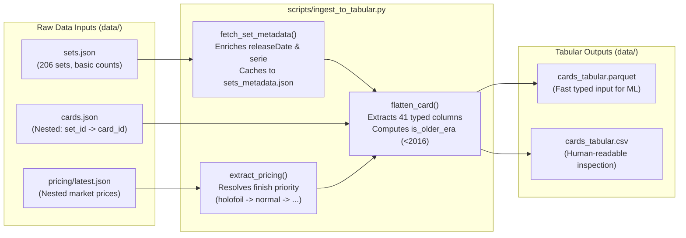

# 01 — Data Ingestion & Tabular Preparation (`scripts/ingest_to_tabular.py`)

[← Back to Modeling Docs Index](file:///Users/thorgy17/Top%20Secret%20Projects/Pokemon%20Modeling/pkm-card-data/docs/README.md)

---

## 1. Purpose & Architectural Role

[`scripts/ingest_to_tabular.py`](file:///Users/thorgy17/Top%20Secret%20Projects/Pokemon%20Modeling/pkm-card-data/scripts/ingest_to_tabular.py) is **Stage 1** of the modeling pipeline. Its job is to take three separate, deeply nested JSON files from the TCGdex data cache and unify them into a single, flat, strictly typed 41-column table (`21,812` rows) saved at [`data/cards_tabular.parquet`](file:///Users/thorgy17/Top%20Secret%20Projects/Pokemon%20Modeling/pkm-card-data/data/cards_tabular.parquet) (and [`data/cards_tabular.csv`](file:///Users/thorgy17/Top%20Secret%20Projects/Pokemon%20Modeling/pkm-card-data/data/cards_tabular.csv)).



### Why Does This Separate Ingestion Step Exist?

1. **Raw JSONs are Hierarchically Mismatched**:
   * [`data/cards.json`](file:///Users/thorgy17/Top%20Secret%20Projects/Pokemon%20Modeling/pkm-card-data/data/cards.json) is a two-level dictionary keyed by `{set_id: {card_id: card_object}}`.
   * [`data/pricing/latest.json`](file:///Users/thorgy17/Top%20Secret%20Projects/Pokemon%20Modeling/pkm-card-data/data/pricing/latest.json) is a flat dictionary keyed by `{card_id: pricing_object}`, where each card's price is further nested by marketplace (`tcgplayer` vs. `cardmarket`) and foil finish (`holofoil`, `normal`, `reverse-holofoil`, `1st-edition-holofoil`, etc.).
   * [`data/sets.json`](file:///Users/thorgy17/Top%20Secret%20Projects/Pokemon%20Modeling/pkm-card-data/data/sets.json) is a list of set summaries that **lacks release dates and series names**—without which we cannot even tell whether a card is Vintage (`< 2016`) or Modern (`>= 2016`).
2. **Decoupling I/O Parsing from Feature Engineering Iteration**:
   * Parsing ~80 MB of nested JSON files takes several seconds of CPU time. By flattening the raw data once into [`data/cards_tabular.parquet`](file:///Users/thorgy17/Top%20Secret%20Projects/Pokemon%20Modeling/pkm-card-data/data/cards_tabular.parquet), [`src/train.py`](file:///Users/thorgy17/Top%20Secret%20Projects/Pokemon%20Modeling/pkm-card-data/src/train.py) can load all 21,812 cards in **< 50 milliseconds** with preserved data types (`float64`, `int64`, `bool`, `string`).
3. **Why Both `.parquet` and `.csv`?**:
   * **Parquet** (`cards_tabular.parquet`) is used by the Python ML pipeline because it is columnar, compressed, fast to read, and preserves exact `None`/`NaN` vs. boolean/numeric types (CSV readers frequently misinfer mixed-type columns like `local_id`, which contains strings like `"H1"`, `"TG01"`, and `"199"`).
   * **CSV** (`cards_tabular.csv`) is exported purely for human convenience so you can open the dataset in Excel, DuckDB, or a text editor for ad-hoc inspection.

---

## 2. File Walkthrough & Justification by Function

### 2.1 Enriching & Caching Set Metadata: [`fetch_set_metadata()`](file:///Users/thorgy17/Top%20Secret%20Projects/Pokemon%20Modeling/pkm-card-data/scripts/ingest_to_tabular.py#L19-L75)

#### What it does
Checks if [`data/sets_metadata.json`](file:///Users/thorgy17/Top%20Secret%20Projects/Pokemon%20Modeling/pkm-card-data/data/sets_metadata.json) exists on disk. If it does, it loads and returns it immediately. If not, it iterates through all 206 sets in [`data/sets.json`](file:///Users/thorgy17/Top%20Secret%20Projects/Pokemon%20Modeling/pkm-card-data/data/sets.json) and queries `https://api.tcgdex.net/v2/en/sets/{sid}` concurrently using a 20-worker `ThreadPoolExecutor`, saving the enriched dictionary to `data/sets_metadata.json`.

```python
# scripts/ingest_to_tabular.py (lines 46-54)
return sid, {
    "id": sid,
    "name": data.get("name", s.get("name")),
    "releaseDate": release_date,
    "releaseYear": release_year,
    "serie": serie,
    "officialCardCount": data.get("cardCount", {}).get("official"),
    "totalCardCount": data.get("cardCount", {}).get("total")
}
```

#### Why it is set up this way
* **The Missing Era Problem**: The brief set objects in `data/sets.json` only include `id`, `name`, `logo`, `symbol`, and `cardCount`. They do **not** include `releaseDate` (e.g., `"1999-01-09"` or `"2023-09-22"`) or `serie` (e.g., `"Base"`, `"Neo"`, `"Scarlet & Violet"`).
* **Why `releaseYear` and `serie` are critical downstream**:
  1. `releaseYear` determines `is_older_era = (rel_year < 2016)`, which is the fundamental split between our **Vintage Training Set** and our **Modern Query Set**.
  2. `releaseYear` is also needed by [`_compute_true_rarity_tier()`](file:///Users/thorgy17/Top%20Secret%20Projects/Pokemon%20Modeling/pkm-card-data/src/features.py#L184-L244) in [`src/features.py`](file:///Users/thorgy17/Top%20Secret%20Projects/Pokemon%20Modeling/pkm-card-data/src/features.py) to identify 1999–2003 WOTC Holo-Only Rares (`yr <= 2003`) and vintage Full-Art Supporters (`yr < 2016`).
  3. `serie` is required by [`build_image_url()`](file:///Users/thorgy17/Top%20Secret%20Projects/Pokemon%20Modeling/pkm-card-data/src/features.py#L139-L146) because TCGdex's image CDN structures paths as `https://assets.tcgdex.net/en/{serie}/{set_id}/{local_id}/high.webp`.
  4. `officialCardCount` is required by [`_parse_set_position()`](file:///Users/thorgy17/Top%20Secret%20Projects/Pokemon%20Modeling/pkm-card-data/src/features.py#L160-L181) to detect Secret Rares (`card_number > officialCardCount`).
* **Why cache to `data/sets_metadata.json`?**: Making 206 HTTP calls on every ingestion run would be slow and fragile if offline. Caching the result in `data/sets_metadata.json` makes subsequent runs 100% offline and deterministic.

---

### 2.2 Selecting the Canonical Card Price: [`extract_pricing()`](file:///Users/thorgy17/Top%20Secret%20Projects/Pokemon%20Modeling/pkm-card-data/scripts/ingest_to_tabular.py#L98-L149)

#### What it does
Given a card's entry from `data/pricing/latest.json`, this function extracts a single primary USD `market_price` (along with `low_price`, `mid_price`, `high_price`, and `tcgplayer_variant_used`) from the `tcgplayer` object, plus EUR `avg` and `trend` prices from `cardmarket`.

```python
# scripts/ingest_to_tabular.py (lines 122-139)
priority = [
    "holofoil",
    "normal",
    "reverse-holofoil",
    "1st-edition-holofoil",
    "1st-edition",
    "unlimited-holofoil",
    "unlimited",
]
for finish in priority:
    sub = tcp.get(finish)
    if isinstance(sub, dict) and sub.get("marketPrice") is not None:
        res["tcgplayer_market_price"] = float(sub["marketPrice"])
        ...
        res["tcgplayer_variant_used"] = finish
        break
```

#### Why it is set up this way
A single Pokémon card ID in TCGdex (for example, Base Set Charizard `base1-4` or an Expedition Rare) can have **multiple simultaneous finishes** listed under `pricing.tcgplayer`:
* `holofoil` (Standard Unlimited Holofoil)
* `1st-edition-holofoil` (1st Edition stamp Holofoil — often 5x–20x more expensive and low liquidity)
* `reverse-holofoil` (Reverse foil parallel — for vintage e-Card/Legendary Collection sets or modern standard sets)
* `normal` (Non-holo printing)

The priority list `["holofoil", "normal", "reverse-holofoil", "1st-edition-holofoil", ...]` solves three domain problems:
1. **Why `"holofoil"` is #1 (before `"normal"` and `"reverse-holofoil"`)**:
   * For any chase card or Holo Rare, collectors value the primary **Holofoil** version. Some cards in TCGdex (such as deck-exclusive non-holo reprints or reverse-holo parallels shared under the same ID) have both a `holofoil` and a cheaper `normal` or `reverse-holofoil` sub-entry. Putting `"holofoil"` first guarantees we capture the true primary foil price for holo cards.
   * For genuinely non-holo cards (Commons, Uncommons, Non-Holo Rares), `"holofoil"` is absent/`None`, so the loop naturally falls through to `"normal"`.
2. **Why `"1st-edition-holofoil"` is placed *after* `"holofoil"` and `"normal"`**:
   * Modern cards (`2016+`) do **not** have 1st Edition print runs; their prices reflect standard unlimited pack pulls.
   * If we used 1st Edition prices whenever available on 1999–2002 WOTC cards, the vintage benchmark pool would measure a discontinued "1st Edition stamp premium" rather than organic card maturation, inflating projections unrealistically. We only fall back to `1st-edition-holofoil` / `1st-edition` if the standard `holofoil` / `normal` key is missing in the API snapshot.
3. **Why `tcgplayer_variant_used` (saved as `pricing_variant`) is recorded**:
   * In several Black & White and XY era sets (e.g., *Plasma Storm* Secret Rare Charizard `bw8-136`), the raw TCGdex catalog erroneously reports `variants.holo = False`.
   * However, TCGplayer's pricing data accurately lists the price under `"holofoil"`. By saving `pricing_variant = "holofoil"` during ingestion, [`src/features.py`](file:///Users/thorgy17/Top%20Secret%20Projects/Pokemon%20Modeling/pkm-card-data/src/features.py#L288-L292) is able to cross-check `pricing_variant` and repair missing `has_holo` flags!

---

### 2.3 Parsing Attack Damage Strings: [`parse_damage_value()`](file:///Users/thorgy17/Top%20Secret%20Projects/Pokemon%20Modeling/pkm-card-data/scripts/ingest_to_tabular.py#L78-L95)

#### What it does
Uses regex (`re.findall(r"\d+", damage_val)`) to turn strings like `"40+"`, `"10x"`, `"120-"`, or `"30"` into clean floats (`40.0`, `10.0`, `120.0`, `30.0`), or `None` if an attack deals no numeric damage.

#### Why it is set up this way
* In `data/cards.json`, the `damage` field on attacks is untyped: it can be an integer (`100`), a string with modifiers (`"30x"`), or missing (`None`). Parquet requires a uniform column type (`float64`) across all 21,812 rows, so `parse_damage_value()` normalizes it before DataFrame construction.

---

### 2.4 Flattening Each Card Record: [`flatten_card()`](file:///Users/thorgy17/Top%20Secret%20Projects/Pokemon%20Modeling/pkm-card-data/scripts/ingest_to_tabular.py#L152-L275)

#### What it does
Takes `(card, pricing_entry, set_meta)` for a single card and returns a flat 41-key dictionary organized into 5 logical groups:

| Column Group | Columns Produced | Downstream Usage |
| :--- | :--- | :--- |
| **1. Identifiers & Era** | `card_id`, `name`, `local_id`, `raw_image_url`, `set_id`, `set_name`, `series`, `release_date`, `release_year`, `is_older_era` | Used for indexing, CDN image URL building (`raw_image_url` + series/set fallback), set position parsing, and the `< 2016` Vintage vs. `>= 2016` Modern split (`is_older_era`). |
| **2. Classification & Lore** | `category`, `rarity`, `stage`, `primary_type`, `secondary_type`, `types_count`, `dex_id`, `evolve_from`, `illustrator` | Primary inputs to [`src/features.py`](file:///Users/thorgy17/Top%20Secret%20Projects/Pokemon%20Modeling/pkm-card-data/src/features.py) for rarity reconstruction, evolution graphs, species/artist prestige, archetypes, and elemental types. |
| **3. Gameplay / Battle Stats** | `hp`, `retreat`, `attack_count`, `max_attack_damage`, `min_attack_damage`, `total_attack_energy_cost`, `ability_count`, `weakness_type`, `resistance_type` | Stored in the Parquet table for dataset completeness and exploratory analysis, but **deliberately excluded** from KNN similarity features. |
| **4. Printings & Finishes** | `has_normal`, `has_holo`, `has_reverse`, `has_first_edition`, `legal_standard`, `legal_expanded` | Used in [`src/features.py`](file:///Users/thorgy17/Top%20Secret%20Projects/Pokemon%20Modeling/pkm-card-data/src/features.py) both as finish features and to detect WOTC Holo-Only Rares (`has_holo and not has_normal`). |
| **5. Market Pricing Labels** | `market_price`, `low_price`, `mid_price`, `high_price`, `pricing_variant`, `cardmarket_avg_eur`, `cardmarket_trend_eur` | `market_price` is the target valuation metric (and input to vintage-only Bayesian prestige priors); `pricing_variant` repairs missing holo flags. |

#### Key Design Justifications in `flatten_card()`

1. **Why is `is_older_era` defined specifically as `rel_year < 2016`?** ([line 234](file:///Users/thorgy17/Top%20Secret%20Projects/Pokemon%20Modeling/pkm-card-data/scripts/ingest_to_tabular.py#L234))
   * **2016 (The 20th Anniversary / *Generations* / *Evolutions* / transition to *Sun & Moon*)** marks the structural boundary in Pokémon TCG history between lower-supply vintage/mid-era print runs (WOTC, ex-era, Diamond & Pearl, HeartGold & SoulSilver, Black & White, early XY) and the modern high-print collector era.
   * Cards released before 2016 have had **10 to 27 years** of out-of-print supply attrition (opened packs, graded slabs, lost/damaged copies) and have reached mature secondary-market price equilibrium.
   * Cards released from 2016 onward are either still in active circulation or still moving through their post-release maturation curve.
2. **Why extract only `dex_ids[0]` into `dex_id`?** ([lines 213–214](file:///Users/thorgy17/Top%20Secret%20Projects/Pokemon%20Modeling/pkm-card-data/scripts/ingest_to_tabular.py#L213-L214))
   * In TCGdex, `dexId` is a list of integers (e.g., `[6]` for Charizard, or two IDs for Tag Team / LEGEND dual-Pokémon cards). Extracting the primary `dex_ids[0]` as a clean integer allows direct dictionary joins for National Pokédex generation bounds (`GEN_BOUNDS`), archetype sets (`STARTERS`, `LEGENDARIES`, `FAN_FAVORITES`), and empirical `species_prestige`.
3. **Why are Gameplay Stats (`hp`, `max_attack_damage`, `retreat`) extracted here if the KNN model doesn't use them?**
   * Keeping [`scripts/ingest_to_tabular.py`](file:///Users/thorgy17/Top%20Secret%20Projects/Pokemon%20Modeling/pkm-card-data/scripts/ingest_to_tabular.py) as an agnostic **data engineering layer** means `data/cards_tabular.parquet` captures the complete schema of a Pokémon card.
   * Earlier during V1 exploration, having these columns in `cards_tabular.parquet` made it possible to empirically prove that `hp`, `attack_damage`, and `retreat` suffer from **era power creep** (a 1999 Base Set Charizard has `120 HP`, whereas a 2023 Charizard ex has `330 HP`—matching on `hp` would force modern chase cards to never match vintage cards!) and have near-zero correlation with collector price within an era. Thus, [`src/features.py`](file:///Users/thorgy17/Top%20Secret%20Projects/Pokemon%20Modeling/pkm-card-data/src/features.py) leaves them out of `FEATURE_COLS`.

---

## 3. Summary Output Statistics

When you run `python3 scripts/ingest_to_tabular.py`, `main()` ([lines 277–324](file:///Users/thorgy17/Top%20Secret%20Projects/Pokemon%20Modeling/pkm-card-data/scripts/ingest_to_tabular.py#L277-L324)) iterates through all sets and cards and outputs:
* **Total cards flattened**: `21,812` rows $\times$ `40` columns
* **Older era cards (`< 2016`)**: `8,994` total (`7,964` with active USD `market_price > 0` used for training)
* **Newer era cards (`>= 2016`)**: `12,818` cards (used as the modern query catalog)

---

**Next Step in Pipeline**: [02 — Feature Engineering Deep-Dive (`src/features.py`) →](file:///Users/thorgy17/Top%20Secret%20Projects/Pokemon%20Modeling/pkm-card-data/docs/02-feature-engineering.md)
