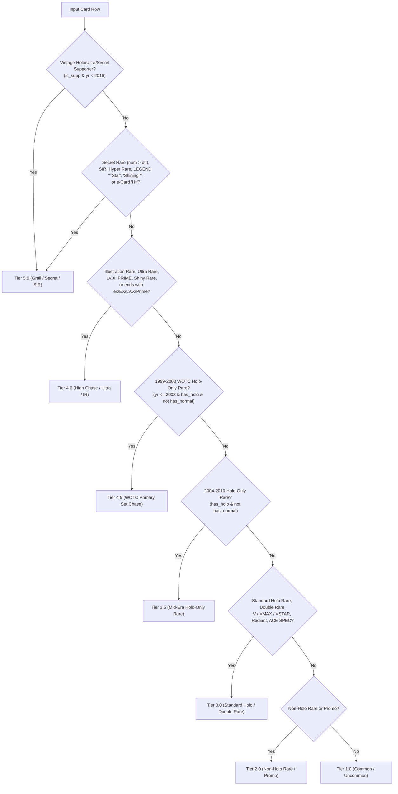

# 02 — Feature Engineering Deep-Dive (`src/features.py`)

[← 01: Data Ingestion](file:///Users/thorgy17/Top%20Secret%20Projects/Pokemon%20Modeling/pkm-card-data/docs/01-data-ingestion.md) | [Back to Modeling Docs Index](file:///Users/thorgy17/Top%20Secret%20Projects/Pokemon%20Modeling/pkm-card-data/docs/README.md) | [03: Training & Inference →](file:///Users/thorgy17/Top%20Secret%20Projects/Pokemon%20Modeling/pkm-card-data/docs/03-training-and-inference.md)

---

## 1. Role of `src/features.py` & Core Design Guardrails

[`src/features.py`](file:///Users/thorgy17/Top%20Secret%20Projects/Pokemon%20Modeling/pkm-card-data/src/features.py) is the **domain brain** of the V2 similarity engine. It transforms the 40 raw columns from [`data/cards_tabular.parquet`](file:///Users/thorgy17/Top%20Secret%20Projects/Pokemon%20Modeling/pkm-card-data/data/cards_tabular.parquet) into **31 unit-range (`[0, 1]`) collector prestige dimensions** (`FEATURE_COLS`) and defines their domain importance weights (`FEATURE_WEIGHTS`).

Before examining the code line-by-line, it is essential to understand the **four foundational "whys"** that govern how this file is constructed:

### 1.1 Why Exclude Gameplay Stats (`hp`, `damage`, `retreat`, `attacks`)?
In the Pokémon TCG, tournament playability and collector value are almost completely orthogonal:
* **Era Power Creep**: A 1999 *Base Set Charizard* has `120 HP` and deals `100` damage. A 2023 *151 Charizard ex* has `330 HP` and deals `330` damage. If `hp` or `max_attack_damage` were included in the KNN feature vector, a modern `330 HP` chase card would be mathematically pushed away from `120 HP` vintage grails.
* **Collector Indifference to Battle Mechanics**: A 30 HP *Shining Magikarp* or a 0-attack *Illustrator Pikachu* sells for hundreds or thousands of dollars, whereas playable competitive cards drop to $0.50 once they rotate out of the Standard tournament format.

### 1.2 Why Unit-Range `[0, 1]` Normalization Beats `StandardScaler(with_std=True)`
In standard tabular machine learning, practitioners often reach for `StandardScaler()`, which transforms each feature $x$ into $z = \frac{x - \mu}{\sigma}$. **In a weighted cosine KNN space with sparse binary indicators, dividing by $\sigma$ is catastrophic.**

> [!IMPORTANT]
> **Mathematical Proof of the `StandardScaler` Trap**:
> Suppose a binary indicator $B \in \{0, 1\}$ (such as `has_first_edition` or a rare elemental type) is `1` for only $p = 1\%$ of cards ($0.01$).
> Its standard deviation is:
> $$\sigma = \sqrt{p(1 - p)} = \sqrt{0.01 \times 0.99} \approx 0.0995$$
> When `StandardScaler` divides by $\sigma$, any card with $B = 1$ gets scaled to:
> $$z = \frac{1 - 0.01}{0.0995} \approx \mathbf{9.95}$$
> Meanwhile, a dense, core continuous feature like `rarity_norm` ($\sigma \approx 0.35$) only reaches $z \approx 2.5$. A rare binary flag gets **inflated by ~10x to 30x**, completely drowning out `species_prestige` and `rarity_norm`!

**How `src/features.py` solves this**:
* Every single feature in [`FEATURE_COLS`](file:///Users/thorgy17/Top%20Secret%20Projects/Pokemon%20Modeling/pkm-card-data/src/features.py#L136) is explicitly engineered in [`src/features.py`](file:///Users/thorgy17/Top%20Secret%20Projects/Pokemon%20Modeling/pkm-card-data/src/features.py) to live strictly on **`[0.0, 1.0]`**.
* When we multiply a `[0, 1]` feature by its weight $w_i$ in [`FEATURE_WEIGHTS`](file:///Users/thorgy17/Top%20Secret%20Projects/Pokemon%20Modeling/pkm-card-data/src/features.py#L102-L134), its maximum contribution along that axis is **guaranteed to be exactly $w_i$**. For example, `rarity_norm` (weight `4.5`) always has maximum leverage `4.5`, and `has_first_edition` (weight `0.8`) never exceeds `0.8`.

### 1.3 Why Zero Price Leakage (`< 2016` Only for Empirical Priors)?
Two features in `src/features.py`—`species_prestige` and `artist_prestige`—use market prices to quantify how much collectors pay for a specific Pokémon species (e.g., *Charizard* vs. *Venusaur*) or illustrator (e.g., *Mitsuhiro Arita* vs. a CGI studio).
* If we used `2016+` modern card prices when computing those averages, we would **leak** a modern card's current price into its own feature vector.
* Therefore, [`src/features.py` (line 366)](file:///Users/thorgy17/Top%20Secret%20Projects/Pokemon%20Modeling/pkm-card-data/src/features.py#L366) computes species and artist price residuals **strictly on `< 2016` vintage cards** (`df["is_older_era"] == True`).

### 1.4 Why 31 Features? (Solving V1 Vector Collisions)
In an earlier V1 prototype that used only 13 coarse binary/categorical features (basic rarity, era, and coarse archetype), **12,818 modern cards collapsed onto only 358 unique feature vectors (`2.8%`)**. For example, *Charizard*, *Venusaur*, and *Blastoise* of the same rarity in the same set had the **exact same vector** (`100%` collision), so they returned the exact same 5 vintage neighbors.
By introducing continuous intra-set ratios (`set_position_ratio`, `set_size_norm`), intra-generation Pokédex position (`gen_relative_dex`), empirical Bayesian `species_prestige` and `artist_prestige`, biological evolution finality (`is_fully_evolved`), and elemental type flags (`type_*`), **99.0% of modern cards (`12,694 / 12,818`) now possess a unique vector**.

---

## 2. Section-by-Section Walkthrough of `src/features.py`

### 2.1 Top-Level Constants & Lookup Tables ([Lines 13–136](file:///Users/thorgy17/Top%20Secret%20Projects/Pokemon%20Modeling/pkm-card-data/src/features.py#L13-L136))

At the top of [`src/features.py`](file:///Users/thorgy17/Top%20Secret%20Projects/Pokemon%20Modeling/pkm-card-data/src/features.py), several domain lookup sets and maps are defined. Here is **why** each one exists:

1. **`STARTERS` ([lines 13–23](file:///Users/thorgy17/Top%20Secret%20Projects/Pokemon%20Modeling/pkm-card-data/src/features.py#L13-L23)), `LEGENDARIES` ([lines 25–35](file:///Users/thorgy17/Top%20Secret%20Projects/Pokemon%20Modeling/pkm-card-data/src/features.py#L25-L35)), and `FAN_FAVORITES` ([lines 37–48](file:///Users/thorgy17/Top%20Secret%20Projects/Pokemon%20Modeling/pkm-card-data/src/features.py#L37-L48))**:
   * **What they are**: Hardcoded sets of National Pokédex IDs (`dex_id`) across Generations 1–9.
   * **Why they exist**: While empirical `species_prestige` measures historical price premiums for individual species, we also want **structural archetype clustering** so that a Legendary Pokémon matches other Legendaries, a Starter matches other Starters, and an iconic Fan Favorite (Pikachu `#25`, Eevee & all 8 Eeveelutions `#133..#700`, Gengar `#94`, Gyarados `#130`, Dragonite `#149`, Tyranitar `#248`, Gardevoir `#282`, Rayquaza/Salamence/Metagross, Garchomp `#445`, Lucario `#448`, Mimikyu `#778`, etc.) matches other Fan Favorites—especially for newer Gen 7–9 Pokémon that didn't exist before 2016!
2. **`RENOWNED_ARTISTS` ([lines 50–54](file:///Users/thorgy17/Top%20Secret%20Projects/Pokemon%20Modeling/pkm-card-data/src/features.py#L50-L54)) & `CGI_STUDIOS` ([lines 56–59](file:///Users/thorgy17/Top%20Secret%20Projects/Pokemon%20Modeling/pkm-card-data/src/features.py#L56-L59))**:
   * **What they are**: Curated lists of iconic hand-drawn illustrators (*Ken Sugimori, Mitsuhiro Arita, Naoki Saito, Kouki Saitou, Kagemaru Himeno, Atsuko Nishida, Masakazu Fukuda, Tomokazu Komiya, Yuka Morii, Ryo Ueda, Shinji Kanda, Akira Egawa, sowsow, HYOGONOSUKE*) versus mass-production 3D CGI render houses (*5ban Graphics, Planeta, aky CG Works, Eske Yoshinob*).
   * **Why they exist**: Modern fan-favorite artists like *Shinji Kanda* (famous for Giratina V Alt Art and Magikarp IR) or *Akira Egawa* debuted after 2016, so they have zero `< 2016` vintage cards in the training set! Conversely, 3D CGI studios (*5ban Graphics*, *Planeta*) produce generic 3D renders that collectors systematically discount compared to bespoke illustrations. Adding a `+0.35` prior boost for `RENOWNED_ARTISTS` and a `-0.35` penalty for `CGI_STUDIOS` bridges modern artist prestige with vintage illustrator legends.
3. **`ITEM_TRAINER_KEYWORDS` ([lines 61–74](file:///Users/thorgy17/Top%20Secret%20Projects/Pokemon%20Modeling/pkm-card-data/src/features.py#L61-L74))**:
   * **Why it exists**: In TCGdex's raw JSON schema, `category == "Trainer"` is used for **both** human character Supporters (*Iono*, *Miriam*, *Lillie*, *Sabrina*, *Bianca*) and inanimate Item/Tool/Stadium cards (*Ultra Ball*, *Rare Candy*, *Switch*, *Lost Vacuum*). In the collector market, Full-Art human Supporters are top-tier chase cards, whereas gold Item/Stadium cards trade at a fraction of their value. `ITEM_TRAINER_KEYWORDS` contains ~100 object/location nouns (`"Ball"`, `"Potion"`, `"Switch"`, `"Rod"`, `"Stadium"`, `"Temple"`, `"Forest"`, `"Crystal"`, etc.) used by [`_is_supporter_trainer()`](file:///Users/thorgy17/Top%20Secret%20Projects/Pokemon%20Modeling/pkm-card-data/src/features.py#L149-L157) to cleanly separate human Supporters from Items/Stadiums.
4. **`GEN_BOUNDS` ([lines 76–86](file:///Users/thorgy17/Top%20Secret%20Projects/Pokemon%20Modeling/pkm-card-data/src/features.py#L76-L86))**:
   * Maps National Pokédex ranges (`1–151` for Gen 1, `152–251` for Gen 2, ..., `906–1025` for Gen 9) to a calibrated **Generation Nostalgia Score** (`1.00` for Gen 1 Kanto, `0.90` for Gen 2 Johto, `0.70` for Gen 3 Hoenn, `0.55` for Gen 4 Sinnoh, `0.25` for Gen 5–6, `0.35` for Gen 7–9).
5. **`STAGE_NORM_MAP` ([lines 88–99](file:///Users/thorgy17/Top%20Secret%20Projects/Pokemon%20Modeling/pkm-card-data/src/features.py#L88-L99))**:
   * Maps card `stage` strings into `[0, 1]`: `"Basic"` $\rightarrow$ `0.25`, `"Stage1"` / `"RESTORED"` $\rightarrow$ `0.50`, `"Stage2"` $\rightarrow$ `0.75`, and apex mechanics (`"VMAX"`, `"VSTAR"`, `"MEGA"`, `"LEVEL-UP"`, `"BREAK"`, `"V-UNION"`) $\rightarrow$ `1.00` (with non-Pokémon Trainers/Energy mapping to `0.0`).

---

### 2.2 Helper Functions ([Lines 139–254](file:///Users/thorgy17/Top%20Secret%20Projects/Pokemon%20Modeling/pkm-card-data/src/features.py#L139-L254))

#### 1. [`build_image_url(card_id, set_id, series, local_id, raw_image_url=None)`](file:///Users/thorgy17/Top%20Secret%20Projects/Pokemon%20Modeling/pkm-card-data/src/features.py#L204-L281)
* **How it works**: Resolves each card's high-resolution artwork URL using a 4-tier hierarchy:
  1. **Canonical TCGdex `raw_image_url`**: Uses `card["image"] + "/high.webp"` directly when present in `data/cards.json` (`91.9%` of cards).
  2. **TCGdex Parent-Set Subset Mapping (`TCGDEX_PARENT_SET_MAP`)**: Routes Trainer Gallery (`swsh9tg`–`swsh12tg`), Galarian Gallery (`swsh12.5gg`), Shiny Vault (`swsh4.5sv`), and e-Card `a/b` barcode variants (`50a` $\rightarrow$ `50`) to their parent set paths on TCGdex.
  3. **Official Pokémon TCG API CDN (`PTCG_IO_SET_MAP`)**: Routes sets and holo subsets omitted by TCGdex (`sm3.5` *Shining Legends*, `sm7.5` *Dragon Majesty*, `ecard2`/`ecard3` `H01–H32` holos, `rc` *Radiant Collection*, and missing `smp`/`svp`/`swshp` promos) to `https://images.pokemontcg.io/{ptcg_set}/{local_id}_hires.png`.
  4. **Exact Series Slug Lookup (`SERIES_TO_TCGDEX_SLUG`)**: Maps human-readable series names to TCGdex's short codes (e.g., `"Scarlet & Violet"` $\rightarrow$ `"sv"`, `"Sword & Shield"` $\rightarrow$ `"swsh"`, `"Sun & Moon"` $\rightarrow$ `"sm"`, `"Black & White"` $\rightarrow$ `"bw"`, `"HeartGold & SoulSilver"` $\rightarrow$ `"hgss"`).
* **Why it exists**: Pre-computing verified CDN URLs onto `train_cards.parquet` and `query_cards.parquet` allows the React frontend to load lightweight `/low.webp` thumbnails in search trays and `/high.webp` artwork in appraisal views without needing the 1.4 GB local `pokemon-cards/` folder.

#### 2. [`_is_supporter_trainer(row)`](file:///Users/thorgy17/Top%20Secret%20Projects/Pokemon%20Modeling/pkm-card-data/src/features.py#L149-L157)
* **How it works**: Returns `False` if `row["category"] != "Trainer"`. Otherwise checks if any keyword in `ITEM_TRAINER_KEYWORDS` appears as a substring of `row["name"].lower()`. If no object/stadium keyword matches, it classifies the Trainer card as a human character Supporter (`True`).
* **Why it exists**: Older vintage sets (1999–2010) did not consistently populate a separate `trainerType` field in TCGdex. Keyword filtering works uniformly across all 27 years of sets, ensuring a modern Special Illustration Rare *Miriam* or *Iono* matches vintage Full-Art Supporters (*Bianca*, *Skyla*, *Cheren*) rather than Gold *Ultra Ball* or *Rare Candy*.

#### 3. [`_parse_set_position(row, sets_meta)`](file:///Users/thorgy17/Top%20Secret%20Projects/Pokemon%20Modeling/pkm-card-data/src/features.py#L160-L181)
* **What it returns**: A 3-tuple `(set_position_ratio, is_secret_rare, set_size_norm)`, all bounded in `[0, 1]`.
* **How and why each value is computed**:
  1. `size_norm = np.clip((np.log10(off) - 1.0) / 1.5, 0.0, 1.0)`:
     * Maps `officialCardCount` (`off`) logarithmically from `[10, 316]` cards into `[0.0, 1.0]`. Differentiates mini-sets/promo subsets from massive mainline expansions.
  2. **Special Case for e-Card `H1..H32` Holos** ([lines 171–172](file:///Users/thorgy17/Top%20Secret%20Projects/Pokemon%20Modeling/pkm-card-data/src/features.py#L171-L172)):
     * In 2002–2003 *Aquapolis* and *Skyridge*, the foil chase cards were numbered separately as `H1/H32` through `H32/H32` instead of `148/147`. Without this check (`if lid.startswith("H") and lid[1:].isdigit(): return 1.0, 1.0, size_norm`), `num / off` would treat `H1` as card `#1` (`ratio = 0.006`, `is_secret_rare = 0.0`), misclassifying $500+ Skyridge holos as front-of-set commons!
  3. **Standard Numeric `local_id`** ([lines 174–179](file:///Users/thorgy17/Top%20Secret%20Projects/Pokemon%20Modeling/pkm-card-data/src/features.py#L174-L179)):
     * Extracts the trailing integer `num` from `local_id` and computes:
       $$\text{set\_position\_ratio} = \frac{\min(1.25, \text{num} / \text{off})}{1.25}, \quad \text{is\_secret\_rare} = \mathbb{I}(\text{num} > \text{off})$$
     * **Why `set_position_ratio` matters**: In almost all Pokémon sets, cards are numbered in ascending prestige toward the back of the set (regular cards `1..off`, Ultra Rares/Full Arts near `0.85..1.00 * off`, and Secret Rares / Illustration Rares / Special Illustration Rares at `> 1.00 * off`). Capping at `1.25` and dividing by `1.25` maps regular cards to `[0.0, 0.80]` and Secret Rares to `(0.80, 1.00]`.

#### 4. [`_compute_true_rarity_tier(row)`](file:///Users/thorgy17/Top%20Secret%20Projects/Pokemon%20Modeling/pkm-card-data/src/features.py#L184-L244) — Fixing the 1999–2010 TCGdex Blindspot
* **Why this function is critical**:
  In TCGdex's raw `data/cards.json`, **almost every single chase card printed between 1999 and 2007 is labeled simply as `rarity: "Rare"`**:
  * *Shining Charizard* (`Neo Destiny`, $1,700) $\rightarrow$ `"Rare"`
  * *Charizard Star* (Gold Star, `Dragon Frontiers`, $2,000+) $\rightarrow$ `"Rare"`
  * *Crystal Lugia / Ho-Oh* (`Aquapolis` `149/147`, Secret Rare) $\rightarrow$ `"Rare"`
  * *Skyridge* `H01–H32` Holos $\rightarrow$ `"Rare"`
  * *1999 Base Set Charizard* (`4/102`, Holo-Only Rare) $\rightarrow$ `"Rare"`
  * Meanwhile, a $1.50 non-holo *Electrode* or *Dugtrio* in the exact same set is **also** labeled `"Rare"`!
  If the model trusted raw `rarity` strings, modern `Special illustration rare` cards would never match 1999–2007 Gold Stars, Shining cards, or WOTC Holo Rares, and vintage non-holo Rares would pollute high-tier matches.

* **How `_compute_true_rarity_tier()` reconstructs the 1.0–5.0 collector hierarchy**:



  * Notice lines 225–227:
    ```python
    if yr <= 2003 and r in {"Rare", "Rare Holo"} and has_holo and not has_normal:
        return 4.5
    ```
    In 1999–2003 WOTC sets (*Base Set*, *Jungle*, *Fossil*, *Team Rocket*, *Gym Heroes/Challenge*, *Neo*), cards `#1–#16` were **Holo-Only Rares** (`has_holo == True` and `has_normal == False`), while cards `#17–#32` were **Non-Holo Rares** (`has_normal == True`). Assigning `4.5` (`rarity_norm = 0.875`) to 1999–2003 Holo-Only Rares places them right between Tier 4 (`0.75`) and Tier 5 (`1.00`), accurately reflecting that Holo Rares were the top chase pull of early WOTC sets!

---

### 2.3 Inside `engineer_features(df, sets_meta)` ([Lines 257–406](file:///Users/thorgy17/Top%20Secret%20Projects/Pokemon%20Modeling/pkm-card-data/src/features.py#L257-L406))

Let's walk through all **13 sequential steps** inside [`engineer_features()`](file:///Users/thorgy17/Top%20Secret%20Projects/Pokemon%20Modeling/pkm-card-data/src/features.py#L257-L406) and why each step is written the way it is:

#### Step 1: Biological Pre-Evolution Graph (`pre_evo_dex_ids`, [lines 264–273](file:///Users/thorgy17/Top%20Secret%20Projects/Pokemon%20Modeling/pkm-card-data/src/features.py#L264-L273)) & `is_fully_evolved` ([lines 316–325](file:///Users/thorgy17/Top%20Secret%20Projects/Pokemon%20Modeling/pkm-card-data/src/features.py#L316-L325))
```python
std_evolutions = set(
    df[df["stage"].isin(["Stage1", "Stage2"])]["evolve_from"]
    .dropna()
    .str.strip()
    .unique()
)
std_evolutions = {n for n in std_evolutions if not n.endswith((" V", " EX", " ex", " GX"))}
pre_evo_dex_ids = set(df[df["name"].isin(std_evolutions)]["dex_id"].dropna().astype(int).unique())
```
* **The Problem This Solves**:
  In the Pokémon TCG, many iconic fully-evolved Pokémon are printed as **`stage == "Basic"`** cards when they have rule-box mechanics (for example, *Alakazam ex*, *Zapdos ex*, *Gardevoir EX*, *Lucario V*, or *Mewtwo GX* are all `"Basic"` stage cards, or *M Charizard EX* which evolves from `"Charizard-EX"`).
  If we relied on `stage` to tell whether a Pokémon is fully evolved, a `"Basic"` *Alakazam ex* or *Gardevoir EX* would look identical in evolution stage to an unevolved `"Basic"` *Charmander*, *Squirtle*, or *Ralts* Illustration Rare!
* **How This Code Solves It**:
  1. It scans every standard `Stage1` and `Stage2` card in the entire 21,812-card catalog and collects the names of all Pokémon that appear in `evolve_from` (e.g., `"Charmander"`, `"Charmeleon"`, `"Abra"`, `"Kadabra"`, `"Eevee"`).
  2. It filters out rule-box strings (`" V"`, `" EX"`, `" ex"`, `" GX"`) so that `"Charizard-EX"` (which evolves into `"M Charizard EX"`) does not mark Charizard as an unevolved baby Pokémon.
  3. It maps those pre-evolution names to their National Pokédex IDs (`pre_evo_dex_ids`).
  4. Any Pokémon whose `dex_id` is **not** in `pre_evo_dex_ids` (such as *Charizard* `#6`, *Alakazam* `#65`, *Zapdos* `#145`, *Lugia* `#249`) gets `is_fully_evolved = 1.0` (weight `2.5`), regardless of whether its card mechanic is `Basic`, `Stage2`, `V`, or `MEGA`. Unevolved Pokémon (*Charmander* `#4`, *Pikachu* `#25`, *Eevee* `#133`) get `is_fully_evolved = 0.0`.

#### Steps 2–4: Trainer Split, Set Position, and Normalized Rarity ([lines 274–285](file:///Users/thorgy17/Top%20Secret%20Projects/Pokemon%20Modeling/pkm-card-data/src/features.py#L274-L285))
* Applies `_is_supporter_trainer`, `_parse_set_position`, and `_compute_true_rarity_tier`.
* Normalizes `rarity_tier` (`1.0` to `5.0`) into `rarity_norm`:
  $$\text{rarity\_norm} = \frac{\text{rarity\_tier} - 1.0}{4.0} \in [0.0, 1.0]$$
  With weight **`4.5`** (the highest weight in `FEATURE_WEIGHTS`), `rarity_norm` ensures that Tier 5 grails (`rarity_norm = 1.0`) strongly match Tier 5 vintage grails (`1.0`) or Tier 4.5 WOTC Holo Rares (`0.875`), and never match Tier 1–2 commons or non-holo rares.

#### Step 5: Repaired Holo & Print Finishes ([lines 287–295](file:///Users/thorgy17/Top%20Secret%20Projects/Pokemon%20Modeling/pkm-card-data/src/features.py#L287-L295))
```python
df["has_holo"] = (
    df["has_holo"].astype(bool)
    | df["pricing_variant"].fillna("").str.contains("holofoil")
    | (df["rarity_tier"] >= 3.0)
).astype(float)
```
* **Why this 3-part OR condition exists**:
  In raw `data/cards.json`, several Black & White and XY era Secret Rares and Ultra Rares (such as *Plasma Storm* Secret Rare Charizard `bw8-136`) have `variants.holo == False` due to upstream TCGdex data entry bugs.
  Without repairing `has_holo`, a $650 *Plasma Storm* Secret Rare Charizard would have `has_holo = 0.0` (missing a `1.8` weight dimension!) and be penalized when matching modern holo Charizard chase cards. By checking `pricing_variant.contains("holofoil")` and `rarity_tier >= 3.0`, every holofoil card is guaranteed to have `has_holo = 1.0`.

#### Step 6: Mutually Exclusive Subject Archetype Flags ([lines 296–315](file:///Users/thorgy17/Top%20Secret%20Projects/Pokemon%20Modeling/pkm-card-data/src/features.py#L296-L315))
* Assigns every card to **exactly one** of 7 mutually exclusive archetypes (`arch_key`):
  1. `arch_supporter` (Weight `3.0`) — Human character Trainer cards
  2. `arch_item` (Weight `2.5`) — Item / Tool / Stadium Trainer cards
  3. `arch_energy` (Weight `2.5`) — Energy cards
  4. `arch_legend` (Weight `2.2`) — Mythical & Legendary Pokémon (`dex_id in LEGENDARIES`)
  5. `arch_fav` (Weight `2.0`) — Iconic collector favorites (`dex_id in FAN_FAVORITES`)
  6. `arch_starter` (Weight `2.2`) — Gen 1–9 Starter evolution lines (`dex_id in STARTERS`)
  7. `arch_regular` (Weight `1.5`) — All other standard Pokémon species
* **Why mutually exclusive one-hot flags with high weights (`1.5–3.0`)?**:
  In cosine similarity, mutually exclusive binary flags act as **orthogonal subspace partitions**. Because a card only has `1.0` in its own archetype and `0.0` in the other six, a Trainer Supporter card (`arch_supporter = 3.0`) has zero dot-product overlap on that axis with a Pokémon or an Item card, guaranteeing that Supporters match Supporters, Energies match Energies, Starters match Starters, and Legendaries match Legendaries.

#### Step 8: Special Mechanics & Character/Owner Flags ([lines 327–342](file:///Users/thorgy17/Top%20Secret%20Projects/Pokemon%20Modeling/pkm-card-data/src/features.py#L327-L342))
* **`is_special_mechanic` (Weight `1.8`)**:
  Fires (`1.0`) if the card name ends with `ex`, `EX`, `GX`, `V`, `VMAX`, `VSTAR`, `LV.X`, `Prime`, `LEGEND`, `Star`, starts with `Shining ` or `Radiant `, or has an apex stage (`VMAX`, `MEGA`, `LEVEL-UP`, `BREAK`, `V-UNION`).
  * **Why**: Connects modern rule-box chase mechanics (`Charizard ex`, `Rayquaza VMAX`, `Radiant Charizard`) directly to their historical mechanical predecessors (`Charizard ex` from *FireRed & LeafGreen*, `Rayquaza Star`, `Gengar LV.X`, `Shining Charizard`).
* **`is_character_or_owner` (Weight `1.0`)**:
  Fires (`1.0`) for owner/character-themed cards (`Rocket's`, `Blaine's`, `Dark `, `Light `), Trainer Gallery / Galarian Gallery / Radiant Collection subsets (`tg`, `gg`, `rc`), and full-art `Illustration rare` / `Special illustration rare` cards.
  * **Why**: Modern Illustration Rares and Trainer Gallery cards feature full-card narrative artwork depicting Pokémon in their natural habitats or alongside trainers—the spiritual successor to WOTC *Gym Heroes / Gym Challenge* (`Blaine's`, `Sabrina's`) and *Team Rocket / Neo Destiny* (`Dark`, `Light`) character cards.

#### Steps 9–11: Generation Nostalgia, Elemental Types, and Stage Norm ([lines 343–364](file:///Users/thorgy17/Top%20Secret%20Projects/Pokemon%20Modeling/pkm-card-data/src/features.py#L343-L364))
* **`gen_nostalgia_score` (Weight `1.8`) & `gen_relative_dex` (Weight `0.6`)**:
  * `gen_nostalgia_score` reflects the empirical collector demand hierarchy by Pokédex generation (`1.00` for Gen 1 Kanto, `0.90` for Gen 2 Johto, `0.70` for Gen 3 Hoenn, `0.55` for Gen 4 Sinnoh, etc.).
  * `gen_relative_dex = (dex_id - gen_lo) / (gen_hi - gen_lo)` maps a Pokémon's relative position within its generation's Pokédex to `[0.0, 1.0]`. This служит as a continuous tie-breaker (and softly groups early-dex bugs/birds at `~0.10` vs. late-dex pseudo-legendaries/dragons/mythicals at `~0.95`).
* **9 Elemental Type Flags (`type_*`, Weights `0.8–1.2`)**:
  * One-hot flags for `Fire` (`1.2`), `Darkness` (`1.0`), `Dragon` (`1.0`), `Psychic` (`1.0`), `Lightning` (`1.0`), `Water` (`1.0`), `Colorless` (`0.8`), `Grass` (`0.8`), and `type_other_elem` (`0.8`, grouping `Fighting`, `Metal`, and `Fairy`).
  * **Why**: Prevents a Fire-type chase card from matching a Grass-type or Water-type card when an equivalent Fire-type vintage counterpart exists, and reflects the slightly higher collector premium on Fire, Darkness, Dragon, Psychic, and Lightning cards.

#### Step 12: Empirical Bayesian Species & Artist Prestige ([lines 365–399](file:///Users/thorgy17/Top%20Secret%20Projects/Pokemon%20Modeling/pkm-card-data/src/features.py#L365-L399))

This is the mathematical core of V2. Let's trace the exact equations and code:

```python
# src/features.py (lines 366-384)
train_mask = (df["is_older_era"] == True) & (df["market_price"].notnull()) & (df["market_price"] > 0)
tr = df[train_mask].copy()
tr["log_price"] = np.log1p(tr["market_price"])
tier_medians = tr.groupby("rarity_tier")["log_price"].median().to_dict()
tr["price_residual"] = tr["log_price"] - tr["rarity_tier"].map(tier_medians)

arch_priors = tr.groupby("arch_key")["price_residual"].mean().to_dict()
dex_grp = tr.groupby(["dex_id", "arch_key"])["price_residual"].agg(["count", "mean"]).reset_index()
dex_prestige_map = {}
for _, r in dex_grp.iterrows():
    prior = arch_priors.get(r["arch_key"], 0.0)
    dex_prestige_map[r["dex_id"]] = (r["count"] * r["mean"] + 3.0 * prior) / (r["count"] + 3.0)
```

##### Why Every Line of Step 12 Is Built This Way:
1. **Why `np.log1p(market_price)`?**:
   Card prices follow a heavy right-skewed power law ($0.25 commons to $2,000+ Gold Stars). In linear dollar space, a single $2,000 card would dominate any average. Taking the natural log $\ln(1 + P)$ turns multiplicative price premiums (e.g., "this species sells for 3x its rarity baseline") into additive log-residuals.
2. **Why Subtract `rarity_tier` Medians (`price_residual`) Instead of Averaging Raw Log-Price?**:
   Suppose Pokémon $A$ happened to be printed 5 times in vintage sets, all as Tier 5 Secret Rares, while Pokémon $B$ was printed 20 times as Tier 1 Commons and 2 times as Tier 4 Holos. If we averaged raw log-prices, Pokémon $A$ would look artificially more prestigious just because it had fewer common printings!
   By subtracting the median log-price of each card's `rarity_tier`:
   $$r_i = \ln(1 + P_i) - \text{median}_{c \in \text{tier}(i)}\big(\ln(1 + P_c)\big)$$
   we measure how much **more or less expensive a card is compared to other vintage cards of the exact same rarity tier**.
   * For example, across vintage sets, *Charizard* (`dex_id = 6`) has an average rarity-adjusted log-residual of roughly **`+1.45`** (meaning a vintage Charizard sells for $e^{1.45} \approx 4.3\times$ the median price of its rarity tier!), whereas *Venusaur* (`dex_id = 3`) has a much more modest residual.
3. **Why Empirical Bayes Shrinkage (`k = 3.0` toward `arch_priors`)?**:
   $$\text{raw\_prestige}(d) = \frac{n_d \cdot \bar{r}_d + 3.0 \cdot \mu_{\text{arch}(d)}}{n_d + 3.0}$$
   * If a Pokémon species $d$ has many vintage printings ($n_d = 30$, like Charizard or Pikachu), $\frac{30}{33} \approx 91\%$ of its score comes from its own empirical vintage mean $\bar{r}_d$.
   * If a Pokémon only appeared on $n_d = 1$ vintage card, a single noisy price won't skew its score because $\frac{3}{4} = 75\%$ of its score is shrunk toward its archetype prior $\mu_{\text{arch}(d)}$.
   * **What about Gen 7–9 Pokémon (`dex_id >= 722`) that have $n_d = 0$ vintage cards before 2016?**
     Look at line 381:
     ```python
     raw = dex_prestige_map[did] if (pd.notna(did) and did in dex_prestige_map) else arch_priors.get(row["arch_key"], 0.0)
     ```
     Unseen modern species automatically inherit `arch_priors[arch_key]`—so a modern Gen 9 Legendary (*Miraidon*, *Koraidon*) inherits the vintage Legendary log-residual prior, and a modern Fan Favorite (*Mimikyu*, *Ceruledge*, *Dragapult*) inherits the vintage Fan Favorite prior!
4. **Why Rescale `(raw + 1.5) / 3.5` and Clip to `[0.0, 1.0]`?**:
   * Empirical vintage log-residuals span approximately `[-1.5, +2.0]`. Shifting by `+1.5` and dividing by `3.5` maps the residual linearly onto `[0.0, 1.0]`, where `0.43` represents a neutral `0.0` residual and `0.84+` represents apex grail species like *Charizard* (`0.8428`) and *Umbreon*.
5. **How `artist_prestige` ([lines 386–398](file:///Users/thorgy17/Top%20Secret%20Projects/Pokemon%20Modeling/pkm-card-data/src/features.py#L386-L398)) Works**:
   * Uses the same rarity-adjusted vintage `price_residual`, grouped by `illustrator` with shrinkage factor $k = 5.0$ toward `0.0`:
     $$\text{raw\_art}(a) = \frac{n_a \cdot \bar{r}_a}{n_a + 5.0} + \begin{cases} +0.35 & \text{if } a \in \text{RENOWNED\_ARTISTS} \\ -0.35 & \text{if } a \in \text{CGI\_STUDIOS} \\ 0.0 & \text{otherwise} \end{cases}$$
   * Rescales via `np.clip((raw + 1.0) / 2.5, 0.0, 1.0)` (so an unknown/neutral artist with `raw = 0.0` lands at `1.0 / 2.5 = 0.4000`).

---

## 3. Complete 31-Feature Master Reference (`FEATURE_WEIGHTS`)

Every card is represented by the following 31 columns in [`FEATURE_COLS`](file:///Users/thorgy17/Top%20Secret%20Projects/Pokemon%20Modeling/pkm-card-data/src/features.py#L102-L136), ordered by category:

| # | Feature Name | Weight | Bounds | Formula / Construction Summary | Domain Rationale |
| :-: | :--- | :---: | :---: | :--- | :--- |
| 1 | `rarity_norm` | **4.5** | `[0, 1]` | `(rarity_tier - 1.0) / 4.0` | Primary anchor: ensures grails match grails across eras. |
| 2 | `species_prestige` | **3.5** | `[0, 1]` | Bayesian-smoothed `<2016` log-price residual by `dex_id` | Separates *Charizard* (`0.84`) from *Venusaur* (`0.61`) within the same archetype. |
| 3 | `arch_supporter` | **3.0** | `{0, 1}` | `1.0` if human character Trainer (`_is_supporter_trainer`) | Keeps Full-Art/SIR Supporters matched to vintage Full-Art Supporters. |
| 4 | `is_fully_evolved` | **2.5** | `{0, 1}` | `1.0` if Pokémon `dex_id` is not a pre-evolution in `Stage1`/`Stage2` | Prevents Basic rule-box cards (*Charizard ex*) from matching unevolved basics (*Charmander*). |
| 5 | `arch_item` | **2.5** | `{0, 1}` | `1.0` if Trainer matches `ITEM_TRAINER_KEYWORDS` | Isolates Item, Tool, and Stadium Trainer cards into their own subspace. |
| 6 | `arch_energy` | **2.5** | `{0, 1}` | `1.0` if `category == "Energy"` | Isolates Secret/Holo Energy cards to match vintage Energy cards. |
| 7 | `arch_legend` | **2.2** | `{0, 1}` | `1.0` if `dex_id in LEGENDARIES` | Groups Mythical and Legendary Pokémon across all 9 generations. |
| 8 | `arch_starter` | **2.2** | `{0, 1}` | `1.0` if `dex_id in STARTERS` | Groups Gen 1–9 Starter evolution lines. |
| 9 | `arch_fav` | **2.0** | `{0, 1}` | `1.0` if `dex_id in FAN_FAVORITES` | Groups non-legendary collector icons (Pikachu, Eeveelutions, Gengar, etc.). |
| 10 | `is_secret_rare` | **1.8** | `{0, 1}` | `1.0` if `num > officialCardCount` or e-Card `H1..H32` | Strong indicator for secret pulls beyond the printed set size. |
| 11 | `gen_nostalgia_score` | **1.8** | `[0, 1]` | `GEN_BOUNDS` lookup (`1.0` Gen 1, `0.9` Gen 2, `0.7` Gen 3, ...) | Captures structural collector nostalgia premium for early generations. |
| 12 | `is_special_mechanic` | **1.8** | `{0, 1}` | Regex for `ex/EX/GX/V/VMAX/VSTAR/LV.X/Prime/Star/Shining/Radiant` | Connects modern rule-box chase cards to vintage `ex`/`Star`/`LV.X`/`Shining` cards. |
| 13 | `has_holo` | **1.8** | `{0, 1}` | Repaired holofoil indicator (`has_holo \| holofoil_price \| tier>=3`) | Separates foil collector cards from non-holo printings. |
| 14 | `arch_regular` | **1.5** | `{0, 1}` | `1.0` if standard Pokémon not in Legend/Fav/Starter sets | Baseline orthogonal bucket for regular Pokédex species. |
| 15 | `set_position_ratio` | **1.4** | `[0, 1]` | `min(1.25, num / officialCardCount) / 1.25` | Captures continuous back-of-set chase positioning and secret depth. |
| 16 | `artist_prestige` | **1.4** | `[0, 1]` | Bayesian `<2016` illustrator residual + Renowned (`+0.35`) / CGI (`-0.35`) | Rewards iconic hand-drawn illustrators; penalizes mass-produced 3D CGI renders. |
| 17 | `stage_norm` | **1.2** | `[0, 1]` | `Basic=0.25`, `Stage1=0.50`, `Stage2=0.75`, `VMAX/MEGA/LV.X=1.00` | Captures card-level mechanical evolution progression. |
| 18 | `type_fire` | **1.2** | `{0, 1}` | `1.0` if `primary_type == "Fire"` | Fire-type affinity (weighted `1.2` for historical collector demand). |
| 19 | `is_character_or_owner` | **1.0** | `{0, 1}` | `1.0` for `'s`, `Dark `, `Light `, `tg/gg/rc`, `IR/SIR` | Connects modern Illustration Rares / Trainer Galleries to vintage Gym/Character cards. |
| 20 | `type_darkness` | **1.0** | `{0, 1}` | `1.0` if `primary_type == "Darkness"` | Elemental affinity for Darkness-type Pokémon (Umbreon, Tyranitar, etc.). |
| 21 | `type_dragon` | **1.0** | `{0, 1}` | `1.0` if `primary_type == "Dragon"` | Elemental affinity for Dragon-type Pokémon (Rayquaza, Dragonite, etc.). |
| 22 | `type_psychic` | **1.0** | `{0, 1}` | `1.0` if `primary_type == "Psychic"` | Elemental affinity for Psychic/Ghost-type Pokémon (Mewtwo, Gengar, Mew). |
| 23 | `type_lightning` | **1.0** | `{0, 1}` | `1.0` if `primary_type == "Lightning"` | Elemental affinity for Lightning-type Pokémon (Pikachu, Zapdos, Raikou). |
| 24 | `type_water` | **1.0** | `{0, 1}` | `1.0` if `primary_type == "Water"` | Elemental affinity for Water-type Pokémon (Blastoise, Gyarados, Suicune). |
| 25 | `has_first_edition` | **0.8** | `{0, 1}` | `1.0` if card has a 1st Edition printing flag | Minor secondary finish signal. |
| 26 | `type_colorless` | **0.8** | `{0, 1}` | `1.0` if `primary_type == "Colorless"` | Elemental affinity for Colorless/Flying/Normal Pokémon (Lugia, Snorlax, Eevee). |
| 27 | `type_grass` | **0.8** | `{0, 1}` | `1.0` if `primary_type == "Grass"` | Elemental affinity for Grass-type Pokémon (Venusaur, Celebi, Leafeon). |
| 28 | `type_other_elem` | **0.8** | `{0, 1}` | `1.0` if `primary_type in {"Fighting", "Metal", "Fairy"}` | Consolidated elemental flag for rarer secondary types. |
| 29 | `gen_relative_dex` | **0.6** | `[0, 1]` | `(dex_id - gen_lo) / (gen_hi - gen_lo)` | Intra-generation position tie-breaker (early-route vs. late-dex apex). |
| 30 | `set_size_norm` | **0.5** | `[0, 1]` | `clip((log10(officialCardCount) - 1.0) / 1.5, 0, 1)` | Soft context for expansion size (mini-sets vs. large expansions). |
| 31 | `has_reverse` | **0.5** | `{0, 1}` | `1.0` if card has a Reverse Holofoil printing flag | Minor secondary finish signal. |

---

**Next Step in Pipeline**: [03 — KNN Model Training, Artifact Serialization & Real-Time Inference →](file:///Users/thorgy17/Top%20Secret%20Projects/Pokemon%20Modeling/pkm-card-data/docs/03-training-and-inference.md)
