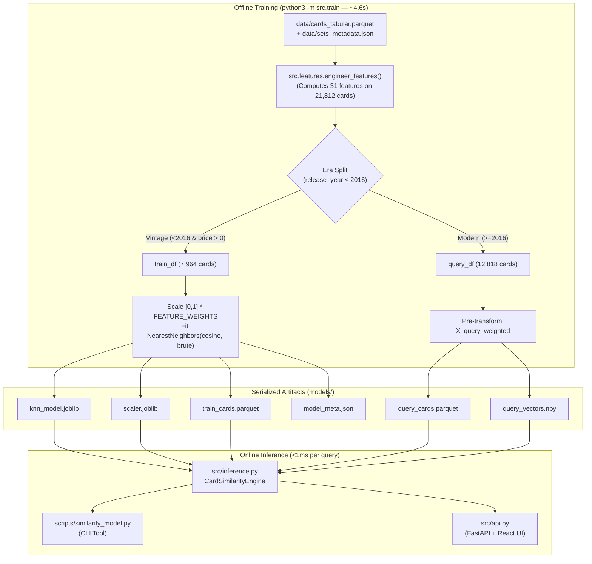

# 03 — KNN Training, Serialization & Real-Time Inference (`src/train.py`, `src/inference.py`, `src/api.py`, `scripts/similarity_model.py`)

[← 02: Feature Engineering](file:///Users/thorgy17/Top%20Secret%20Projects/Pokemon%20Modeling/pkm-card-data/docs/02-feature-engineering.md) | [Back to Modeling Docs Index](file:///Users/thorgy17/Top%20Secret%20Projects/Pokemon%20Modeling/pkm-card-data/docs/README.md)

---

## 1. Architectural Separation: Offline Training vs. Online Inference

A core design principle of this codebase is the strict separation between **offline model building** ([`src/train.py`](file:///Users/thorgy17/Top%20Secret%20Projects/Pokemon%20Modeling/pkm-card-data/src/train.py)) and **online query serving** ([`src/inference.py`](file:///Users/thorgy17/Top%20Secret%20Projects/Pokemon%20Modeling/pkm-card-data/src/inference.py)).



### Why Split `train.py` and `inference.py` This Way?
Running [`engineer_features()`](file:///Users/thorgy17/Top%20Secret%20Projects/Pokemon%20Modeling/pkm-card-data/src/features.py#L257-L406) across all 21,812 cards—building the biological evolution graph, parsing set positions with regex, reconstructing rarities, and fitting Empirical Bayes shrinkage maps—takes **~4.5 seconds**.
* If the CLI or FastAPI server ran feature engineering on the fly during startup or per request, every CLI command would lag by 5 seconds.
* Instead, [`src/train.py`](file:///Users/thorgy17/Top%20Secret%20Projects/Pokemon%20Modeling/pkm-card-data/src/train.py) pre-computes **both** the fitted vintage KNN index *and* the weighted 31-dimensional vectors for all 12,818 modern cards (`models/query_vectors.npy`).
* When [`CardSimilarityEngine`](file:///Users/thorgy17/Top%20Secret%20Projects/Pokemon%20Modeling/pkm-card-data/src/inference.py#L16-L279) starts up in [`src/inference.py`](file:///Users/thorgy17/Top%20Secret%20Projects/Pokemon%20Modeling/pkm-card-data/src/inference.py), it simply memory-loads those pre-built matrices in **~150 milliseconds** and answers individual similarity queries in **under 1 millisecond**.

---

## 2. Deep Dive: [`src/train.py`](file:///Users/thorgy17/Top%20Secret%20Projects/Pokemon%20Modeling/pkm-card-data/src/train.py)

Let's examine each block of [`train_and_export_artifacts()`](file:///Users/thorgy17/Top%20Secret%20Projects/Pokemon%20Modeling/pkm-card-data/src/train.py#L19-L107) and the justification for how it is set up.

### 2.1 Splitting Vintage Training vs. Modern Query Sets ([Lines 37–46](file:///Users/thorgy17/Top%20Secret%20Projects/Pokemon%20Modeling/pkm-card-data/src/train.py#L37-L46))

```python
# 1. Vintage Baseline (<2016 with prices)
train_mask = (df_feat["is_older_era"] == True) & (df_feat["market_price"].notnull()) & (df_feat["market_price"] > 0)
train_df = df_feat[train_mask].copy().reset_index(drop=True)

# 2. Modern Cards (>=2016)
query_mask = (df_feat["is_older_era"] == False)
query_df = df_feat[query_mask].copy().reset_index(drop=True)
```

#### Why is `market_price > 0` required for `train_df`, but NOT for `query_df`?
1. **Why `train_df` requires `market_price > 0` (`7,964` of `8,994` vintage cards)**:
   * Every card in `train_df` is a candidate neighbor in the KNN index whose sole purpose at appraisal time is to provide a **historical price comp** (`vintage_median_price`, `vintage_mean_price`).
   * Roughly 1,030 obscure vintage cards (such as unpriced deck variants or missing TCGplayer listings) have `market_price == NaN`. If unpriced vintage cards were allowed into the KNN index, a modern card's 5 nearest neighbors could return `NaN` prices, reducing the sample size of valid price comps! Filtering them out before `.fit()` guarantees that **100% of returned vintage neighbors have a valid, positive USD market price**.
2. **Why `query_df` keeps ALL `>= 2016` cards (`12,818` cards), even if `market_price` is `NaN`**:
   * Suppose a brand-new set or promo card has just been added to the catalog and doesn't have a TCGplayer `market_price` yet—that is often when a collector *most* wants to know what vintage cards it resembles and what its projected value is! Keeping all `12,818` modern cards in `query_df` ensures every modern card can be searched and appraised (if `current_market_price` is `None`, the engine still outputs the full vintage neighbor list and projected median price, simply omitting the `upside_multiplier` ratio).
3. **Why `.reset_index(drop=True)` is critical on both DataFrames**:
   * `knn.kneighbors()` returns positional row indices `0 .. N-1` into the NumPy training matrix `X_train_weighted`. Calling `.reset_index(drop=True)` ensures `train_df.iloc[indices[0]]` and `query_df.iloc[idx]` align 1-to-1 with row positions in the NumPy arrays.

---

### 2.2 Scaling and Domain Feature Weighting ([Lines 48–59](file:///Users/thorgy17/Top%20Secret%20Projects/Pokemon%20Modeling/pkm-card-data/src/train.py#L48-L59))

```python
scaler = StandardScaler(with_mean=False, with_std=False)
X_train_raw = train_df[FEATURE_COLS].values
X_train_scaled = scaler.fit_transform(X_train_raw)

weights_vec = np.array([FEATURE_WEIGHTS[c] for c in FEATURE_COLS])
X_train_weighted = X_train_scaled * weights_vec
```

#### Why `StandardScaler(with_mean=False, with_std=False)`?
* As proven in [02 — Feature Engineering Deep-Dive](file:///Users/thorgy17/Top%20Secret%20Projects/Pokemon%20Modeling/pkm-card-data/docs/02-feature-engineering.md#12-why-unit-range-0-1-normalization-beats-standardscalerwith_stdtrue), all 31 features in `FEATURE_COLS` are already explicitly normalized to `[0.0, 1.0]` inside `src/features.py`.
* Why keep a `StandardScaler(with_mean=False, with_std=False)` object at all instead of removing it?
  1. **Zero-Mean Centering (`with_mean=True`) Would Break Sparse Orthogonality**: When two cards both lack a feature (e.g., neither is an Energy card: `arch_energy = 0.0` for both), we want that feature to contribute **zero** to their dot product ($\mathbf{u}_i \cdot \mathbf{v}_i = 0 \times 0 = 0$). If we centered features by subtracting the mean (`with_mean=True`), two non-Energy cards would both have `-0.02` and contribute a positive product `(-0.02) * (-0.02) > 0` across all 20+ zero-valued one-hot flags!
  2. **Unit-Variance (`with_std=True`) Would Inflate Rare Flags by 10x–30x**: Keeping `with_std=False` preserves the exact `[0, 1]` bounds.
  3. **Pipeline Compatibility**: Serializing `scaler.joblib` preserves a clean scikit-learn transformation interface for [`src/inference.py`](file:///Users/thorgy17/Top%20Secret%20Projects/Pokemon%20Modeling/pkm-card-data/src/inference.py#L44).

---

### 2.3 Fitting `NearestNeighbors`: Why Cosine Distance + Brute Force? ([Lines 60–64](file:///Users/thorgy17/Top%20Secret%20Projects/Pokemon%20Modeling/pkm-card-data/src/train.py#L60-L64))

```python
knn = NearestNeighbors(n_neighbors=10, metric="cosine", algorithm="brute")
knn.fit(X_train_weighted)
```

#### 1. Why `metric="cosine"` instead of Euclidean (`metric="l2"`)?
For two weighted feature vectors $\mathbf{u} = \mathbf{w} \odot \mathbf{x}$ and $\mathbf{v} = \mathbf{w} \odot \mathbf{y}$, the weighted cosine distance is:
$$D_{\text{cos}}(\mathbf{u}, \mathbf{v}) = 1 - \frac{\sum_{i=1}^{31} (w_i x_i)(w_i y_i)}{\sqrt{\sum_{i=1}^{31} (w_i x_i)^2} \sqrt{\sum_{i=1}^{31} (w_i y_i)^2}}$$
* **Why Cosine Excels Here**:
  1. **Scale-Bounded Similarity Percentage**: Because every feature $x_i, y_i \in [0, 1]$ and every weight $w_i > 0$, all weighted vectors live strictly in the **non-negative orthant** ($\mathbb{R}_{\ge 0}^{31}$). Therefore, the cosine similarity $\cos(\theta)$ is guaranteed to be bounded in **`[0.0, 1.0]`**, and cosine distance $D_{\text{cos}}$ is bounded in **`[0.0, 1.0]`**. This translates directly into an intuitive **`0.0%` to `100.0%` match score** (`(1 - dist) * 100`) without arbitrary exponential kernels!
  2. **Focus on Relative Prestige Profile**: Cosine similarity measures whether two cards point in the **same direction** in collector space (e.g., Tier 5 Rarity + High Species Prestige + Starter Archetype + Fire Type + Special Mechanic).
  3. **Squared Weight Leverage in the Dot Product**: Notice that in the numerator, each feature product is weighted by $w_i^2$. A feature with weight `4.5` (`rarity_norm`) contributes $4.5^2 = 20.25$ to the dot product when both cards have `1.0`, whereas `set_size_norm` (weight `0.5`) contributes only $0.5^2 = 0.25$.

#### 2. Why `algorithm="brute"`?
In `scikit-learn`, `NearestNeighbors` supports `"ball_tree"`, `"kd_tree"`, and `"brute"`:
* **Tree structures (`kd_tree`, `ball_tree`) do not work well here**: `KDTree` does not support `"cosine"` distance at all, and in `31` dimensions, spatial partitioning trees suffer from the curse of dimensionality (requiring traversal of nearly all branches anyway while adding pointer-chasing overhead).
* **Why `"brute"` is blazingly fast**: Our training matrix `X_train_weighted` has shape `(7964, 31)` (~1.9 MB of `float64` memory, fitting entirely inside CPU L2/L3 cache). Computing exact cosine distances via BLAS matrix-vector multiplication (`X_train @ q_vec.T`) across 7,964 rows takes **~0.3 milliseconds** and guarantees **100% exact nearest neighbors**.

---

### 2.4 Pre-Computing Query Vectors & Serializing the 6 Artifacts ([Lines 65–106](file:///Users/thorgy17/Top%20Secret%20Projects/Pokemon%20Modeling/pkm-card-data/src/train.py#L65-L106))

[`src/train.py`](file:///Users/thorgy17/Top%20Secret%20Projects/Pokemon%20Modeling/pkm-card-data/src/train.py) writes 6 synchronized files to `models/`:

| Artifact File | Format | Contents & Purpose |
| :--- | :---: | :--- |
| `models/knn_model.joblib` | Joblib | Fitted `NearestNeighbors` object containing the `7,964 x 31` weighted vintage matrix. |
| `models/scaler.joblib` | Joblib | Identity unit-range `StandardScaler(with_mean=False, with_std=False)`. |
| `models/train_cards.parquet` | Parquet | The `7,964` vintage cards DataFrame (row $i$ corresponds to index $i$ in `knn_model`). |
| `models/query_cards.parquet` | Parquet | The `12,818` modern cards DataFrame with metadata and CDN `image_url`. |
| `models/query_vectors.npy` | NumPy `.npy` | Pre-multiplied `(12818, 31)` matrix (`X_query_weighted`) for $O(1)$ modern card lookup. |
| `models/model_meta.json` | JSON | Audit log recording training timestamp, card counts, `FEATURE_COLS`, `FEATURE_WEIGHTS`, and elapsed runtime. |

---

## 3. Deep Dive: [`src/inference.py`](file:///Users/thorgy17/Top%20Secret%20Projects/Pokemon%20Modeling/pkm-card-data/src/inference.py) (`CardSimilarityEngine`)

[`src/inference.py`](file:///Users/thorgy17/Top%20Secret%20Projects/Pokemon%20Modeling/pkm-card-data/src/inference.py) wraps the serialized `models/` artifacts in a single stateful class, [`CardSimilarityEngine`](file:///Users/thorgy17/Top%20Secret%20Projects/Pokemon%20Modeling/pkm-card-data/src/inference.py#L16-L279), used by both the CLI and FastAPI server.

### 3.1 Startup & $O(1)$ Indexing: [`_load_artifacts()`](file:///Users/thorgy17/Top%20Secret%20Projects/Pokemon%20Modeling/pkm-card-data/src/inference.py#L33-L51)

```python
# Index modern cards for O(1) lookup
for idx, cid in enumerate(self.query_df["card_id"]):
    self.card_id_to_query_idx[cid.lower()] = idx
```
* **Why build `card_id_to_query_idx` at startup?**:
  Instead of scanning a 12,818-row DataFrame (`self.query_df[self.query_df["card_id"] == cid]`) on every query—or worse, during the batch loop in `get_top_gems()`—this Python dictionary maps any lowercase `card_id` (e.g. `"sv03.5-199"`) to its integer row index `idx` in **$O(1)$ constant time** (~50 nanoseconds).

---

### 3.2 Filtering & Searching Modern Cards: [`get_filter_options()`](file:///Users/thorgy17/Top%20Secret%20Projects/Pokemon%20Modeling/pkm-card-data/src/inference.py#L53-L74) & [`search_cards()`](file:///Users/thorgy17/Top%20Secret%20Projects/Pokemon%20Modeling/pkm-card-data/src/inference.py#L76-L120)

* **[`get_filter_options()`](file:///Users/thorgy17/Top%20Secret%20Projects/Pokemon%20Modeling/pkm-card-data/src/inference.py#L53-L74)**:
  Extracts unique modern sets (sorted newest-first by `release_year DESC, set_name ASC`) and unique rarity strings from `self.query_df` to populate the React UI filter dropdowns.
* **[`search_cards(query, set_id, rarity, limit)`](file:///Users/thorgy17/Top%20Secret%20Projects/Pokemon%20Modeling/pkm-card-data/src/inference.py#L76-L120)**:
  * Filters `self.query_df` by optional `set_id`, `rarity`, and case-insensitive substring match against **either** `card_id` or `name`.
  * **Why sort by `["release_year", "market_price"], ascending=[False, False]` ([line 102](file:///Users/thorgy17/Top%20Secret%20Projects/Pokemon%20Modeling/pkm-card-data/src/inference.py#L102))?**:
    If a user types `"Charizard"` or `"Pikachu"` without specifying a card ID, dozens of cards match (including $0.25 commons and promos). Sorting newest-first and highest-price-first ensures that the flagship chase cards (like Special Illustration Rare *Charizard ex*) appear at the very top of the search results and as the default CLI match.
  * **Why `.replace({np.nan: None})` ([line 109](file:///Users/thorgy17/Top%20Secret%20Projects/Pokemon%20Modeling/pkm-card-data/src/inference.py#L109))?**:
    Standard JSON (RFC 8259) does not allow `NaN` floats; FastAPI/Starlette throws a `ValueError: Out of range float values are not JSON compliant` if a pandas `NaN` (e.g., a missing `market_price`) is returned directly. Replacing `np.nan` with `None` serializes cleanly to JSON `null`.

---

### 3.3 Single-Card Similarity & Maturation Appraisal: [`find_similar(card_id, k=5)`](file:///Users/thorgy17/Top%20Secret%20Projects/Pokemon%20Modeling/pkm-card-data/src/inference.py#L137-L214)

Let's trace the two lookup paths and the valuation math inside [`find_similar()`](file:///Users/thorgy17/Top%20Secret%20Projects/Pokemon%20Modeling/pkm-card-data/src/inference.py#L137-L214):

#### 1. Fast Path vs. Fallback Path ([Lines 141–153](file:///Users/thorgy17/Top%20Secret%20Projects/Pokemon%20Modeling/pkm-card-data/src/inference.py#L141-L153))
```python
idx = self.card_id_to_query_idx.get(card_id.lower())
if idx is not None:
    target_card = self.query_df.iloc[idx]
    q_vec = self.query_vectors[idx].reshape(1, -1)
else:
    # On-the-fly transform if not in query_df
    card_meta = self.get_card(card_id)
    if not card_meta:
        return None
    target_card = pd.Series(card_meta)
    raw_vals = np.array([target_card.get(col, 0.0) for col in FEATURE_COLS]).reshape(1, -1)
    scaled = self.scaler.transform(raw_vals)
    q_vec = scaled * self.weights_vec
```
* **Fast Path (`idx is not None`)**: If `card_id` is one of the 12,818 modern cards, its weighted 31-feature vector is already sitting in `self.query_vectors[idx]`. Zero feature transformation is needed.
* **Fallback Path (`else`)**: What if you pass a **vintage** card ID (like `"base1-4"` Base Set Charizard or `"neo4-107"` Shining Charizard) to `find_similar()` via the CLI? Because `self.get_card(card_id)` ([lines 122–135](file:///Users/thorgy17/Top%20Secret%20Projects/Pokemon%20Modeling/pkm-card-data/src/inference.py#L122-L135)) also checks `self.train_df`, the fallback branch extracts its 31 features from `train_df`, scales and weights them on the fly, and queries the KNN index—allowing you to inspect vintage-to-vintage similarity as well!

#### 2. Neighbor Query & Match Score Calculation ([Lines 156–159](file:///Users/thorgy17/Top%20Secret%20Projects/Pokemon%20Modeling/pkm-card-data/src/inference.py#L156-L159))
```python
dists, indices = self.knn.kneighbors(q_vec, n_neighbors=k)

vintage_matches = self.train_df.iloc[indices[0]].copy()
vintage_matches["similarity_score"] = np.round((1 - dists[0]) * 100, 1)
```
* `dists[0]` contains the $k$ cosine distances $D \in [0, 1]$.
* `1 - dists[0]` is the exact cosine similarity $\cos(\theta) \in [0, 1]$, which multiplied by `100` gives the human-readable percentage match (`98.9%`).

#### 3. Price Projection Math: Why Median Over Mean? ([Lines 161–170](file:///Users/thorgy17/Top%20Secret%20Projects/Pokemon%20Modeling/pkm-card-data/src/inference.py#L161-L170))
```python
prices = vintage_matches["market_price"].dropna().tolist()
proj_mean = float(np.mean(prices)) if prices else 0.0
proj_median = float(np.median(prices)) if prices else 0.0
proj_min = float(np.min(prices)) if prices else 0.0
proj_max = float(np.max(prices)) if prices else 0.0

current_price = target_card["market_price"]
current_price_val = float(current_price) if (pd.notnull(current_price) and current_price > 0) else None
upside = round(proj_median / current_price_val, 1) if current_price_val else None
```
* **Why is `proj_median` used for the headline valuation and `upside_multiplier` instead of `proj_mean`?**
  In vintage Pokémon cards, Ultra-Grails like *Gold Stars* (`" Star"`) or *Neo Destiny Shining* cards often trade for **$1,500–$3,000+**, whereas late-vintage *Black & White* or *XY* Secret Rares of the same Pokémon might trade for **$300–$700**.
  * Look at the 5 vintage neighbors for *151 Charizard ex* (`sv03.5-199`):
    `[$313.61, $649.98, $737.50, $1501.23, $1700.99]`
  * The **mean** is `$980.66` (pulled upward by the two $1,500+ grails), whereas the **median** (the middle 3rd card, *Stormfront Charizard*) is **`$737.50`**.
  * Using the **median** makes the projected maturation price statistically robust against single extreme outliers at either end of the top-5 neighbor set, while still reporting `vintage_mean_price`, `vintage_min_price`, and `vintage_max_price` in the response payload so the user sees the full distribution.

---

### 3.4 Batch Discovery Scanner: [`get_top_gems()`](file:///Users/thorgy17/Top%20Secret%20Projects/Pokemon%20Modeling/pkm-card-data/src/inference.py#L216-L279)

```python
chase_rarities = ["Special illustration rare", "Secret Rare", "Illustration rare", "Hyper rare", "Ultra Rare"]
mask = (self.query_df["market_price"] >= min_price)
...
indices_list = [self.card_id_to_query_idx[cid.lower()] for cid in candidates["card_id"]]
cand_vectors = self.query_vectors[indices_list]

dists, nbr_indices = self.knn.kneighbors(cand_vectors, n_neighbors=k)
```

#### Why `get_top_gems()` Is Set Up This Way:
1. **Why Filter by `chase_rarities` and `market_price >= min_price`?**:
   * We want to discover genuine modern collector chase cards (`Special illustration rare`, `Illustration rare`, `Secret Rare`, `Hyper rare`, `Ultra Rare`) whose vintage counterparts command high mature prices.
   * Filtering `market_price >= min_price` (default `$3.00` in the API, `$5.00` in the CLI) filters out bulk cards where a small denominator (e.g. `$0.15`) would produce noisy, meaningless upside multipliers.
2. **Why Vectorized Batch `kneighbors(cand_vectors)`?**:
   * Rather than calling `find_similar()` in a slow Python `for` loop 1,500 times, `get_top_gems()` slices the pre-computed `cand_vectors` matrix (`N_candidates x 31`) and makes **one single vectorized C/BLAS call** to `self.knn.kneighbors(cand_vectors, n_neighbors=k)`. This evaluates every modern chase card in the catalog in **~5 milliseconds total**.
3. **Why Sort by `(r["vintage_median_price"], r["upside_multiplier"]), reverse=True` ([line 278](file:///Users/thorgy17/Top%20Secret%20Projects/Pokemon%20Modeling/pkm-card-data/src/inference.py#L278))?**:
   * Sorting primarily by `vintage_median_price` surfaces the modern chase cards matched to the **highest-ceiling vintage grail archetypes** (such as modern Special Illustration Rare / Ultra Rare *Charizard*, *Rayquaza*, *Latias & Latios*, *Umbreon*, and *Gengar*), using `upside_multiplier` as the secondary tie-breaker when two cards share the exact same vintage neighbor median.

---

## 4. Presentation Layer: CLI ([`scripts/similarity_model.py`](file:///Users/thorgy17/Top%20Secret%20Projects/Pokemon%20Modeling/pkm-card-data/scripts/similarity_model.py)) & REST API ([`src/api.py`](file:///Users/thorgy17/Top%20Secret%20Projects/Pokemon%20Modeling/pkm-card-data/src/api.py))

Because all modeling and lookup logic is encapsulated inside [`CardSimilarityEngine`](file:///Users/thorgy17/Top%20Secret%20Projects/Pokemon%20Modeling/pkm-card-data/src/inference.py#L16-L279), both entrypoints remain thin, clean wrappers:

### 4.1 Standalone CLI: [`scripts/similarity_model.py`](file:///Users/thorgy17/Top%20Secret%20Projects/Pokemon%20Modeling/pkm-card-data/scripts/similarity_model.py)
* Instantiates `engine = CardSimilarityEngine()` once ([line 66](file:///Users/thorgy17/Top%20Secret%20Projects/Pokemon%20Modeling/pkm-card-data/scripts/similarity_model.py#L66)).
* Supports three workflows:
  1. **Direct Card ID Query** (`--card_id "sv03.5-199"`): Calls `engine.find_similar(target_id, k=args.k)` and prints a formatted ASCII report via [`print_similarity_report()`](file:///Users/thorgy17/Top%20Secret%20Projects/Pokemon%20Modeling/pkm-card-data/scripts/similarity_model.py#L22-L44).
  2. **Name Search + Appraisal** (`--card "Zapdos ex"`): Calls `engine.search_cards(query=q_name, limit=1)` to resolve the flagship modern card ID matching that name, then runs `engine.find_similar()`.
  3. **Top Gems Scanner** (`--top-gems 10`): Calls `engine.get_top_gems(min_price=5.0, limit=args.top_gems, k=args.k)` and formats the table via [`print_top_gems_report()`](file:///Users/thorgy17/Top%20Secret%20Projects/Pokemon%20Modeling/pkm-card-data/scripts/similarity_model.py#L47-L55).

### 4.2 FastAPI Backend: [`src/api.py`](file:///Users/thorgy17/Top%20Secret%20Projects/Pokemon%20Modeling/pkm-card-data/src/api.py)
* Instantiates `engine = CardSimilarityEngine()` globally at module import ([line 29](file:///Users/thorgy17/Top%20Secret%20Projects/Pokemon%20Modeling/pkm-card-data/src/api.py#L29)) so all HTTP workers share the in-memory matrices without reloading from disk on each request.
* Exposes 5 JSON endpoints that map 1-to-1 to `CardSimilarityEngine` methods:
  * `GET /api/health` $\rightarrow$ Index counts (`modern_cards_indexed: 12818`, `vintage_cards_indexed: 7964`)
  * `GET /api/options` $\rightarrow$ `engine.get_filter_options()`
  * `GET /api/cards/search` $\rightarrow$ `engine.search_cards(...)`
  * `GET /api/similarity/{card_id}` $\rightarrow$ `engine.find_similar(...)`
  * `GET /api/top-gems` $\rightarrow$ `engine.get_top_gems(...)`
* Mounts the compiled React frontend (`frontend/dist/`) at `/` ([lines 90–92](file:///Users/thorgy17/Top%20Secret%20Projects/Pokemon%20Modeling/pkm-card-data/src/api.py#L90-L92)) so running `./run_app.sh` or `python3 src/api.py` serves both the REST API and web UI from a single port (`http://localhost:8000`).
