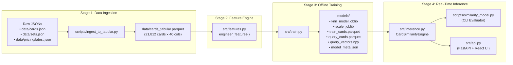

# Pokémon Card KNN Modeling Architecture & Code Justification Guide

Welcome to the deep-dive technical documentation for the **Pokémon Card Collector Similarity & Price Maturation Engine (V2)**.

This documentation suite explains **how** the Python files that build and serve the K-Nearest Neighbors (KNN) model are structured, and **why** every architectural, mathematical, and domain decision was made.

---

## 📚 Documentation Map

| Guide | Python Files Covered | What You Will Learn |
| :--- | :--- | :--- |
| **[00 — Overview & End-to-End Trace](file:///Users/thorgy17/Top%20Secret%20Projects/Pokemon%20Modeling/pkm-card-data/docs/README.md)** *(This File)* | All pipeline files | Why we use KNN instead of regression, why the era boundary is `< 2016`, how all 6 Python scripts fit together, and a complete end-to-end trace of a real card (`sv03.5-199`). |
| **[01 — Data Ingestion & Preparation](file:///Users/thorgy17/Top%20Secret%20Projects/Pokemon%20Modeling/pkm-card-data/docs/01-data-ingestion.md)** | [`scripts/ingest_to_tabular.py`](file:///Users/thorgy17/Top%20Secret%20Projects/Pokemon%20Modeling/pkm-card-data/scripts/ingest_to_tabular.py) | Why raw JSONs are flattened into Parquet/CSV, how missing set release years are fetched/cached, why TCGplayer foil finishes follow a strict priority order, and why `pricing_variant` is saved. |
| **[02 — Feature Engineering Deep-Dive](file:///Users/thorgy17/Top%20Secret%20Projects/Pokemon%20Modeling/pkm-card-data/docs/02-feature-engineering.md)** | [`src/features.py`](file:///Users/thorgy17/Top%20Secret%20Projects/Pokemon%20Modeling/pkm-card-data/src/features.py) | Why gameplay stats are excluded, why `StandardScaler(with_std=True)` fails on sparse flags, how 1999–2010 TCGdex rarities are reconstructed, how `is_fully_evolved` is derived from evolution graphs, and the exact math of Empirical Bayes `species_prestige` & `artist_prestige`. |
| **[03 — Training, Serialization & Inference](file:///Users/thorgy17/Top%20Secret%20Projects/Pokemon%20Modeling/pkm-card-data/docs/03-training-and-inference.md)** | [`src/train.py`](file:///Users/thorgy17/Top%20Secret%20Projects/Pokemon%20Modeling/pkm-card-data/src/train.py) [`src/inference.py`](file:///Users/thorgy17/Top%20Secret%20Projects/Pokemon%20Modeling/pkm-card-data/src/inference.py) [`scripts/similarity_model.py`](file:///Users/thorgy17/Top%20Secret%20Projects/Pokemon%20Modeling/pkm-card-data/scripts/similarity_model.py) [`src/api.py`](file:///Users/thorgy17/Top%20Secret%20Projects/Pokemon%20Modeling/pkm-card-data/src/api.py) | Why training and inference are decoupled via 6 serialized `models/` artifacts, why Cosine + Brute Force is optimal here, why valuation projections use the **median** of vintage neighbors, and how $O(1)$ lookups and vectorized Top Gems scanning work. |

---

## 1. The Big Picture: Why Is the Model Set Up This Way?

### 1.1 Why K-Nearest Neighbors (KNN) Instead of Regression / XGBoost / Neural Networks?
When trying to estimate the long-term matured value of a modern collectible card (e.g., a 2023 *Special Illustration Rare*), a standard supervised regression model (`XGBoost`, `RandomForest`, or a neural network) has two fatal flaws:
1. **Unexplainable Point Predictions**: If a black-box regressor outputs `"$737.50"`, a collector or appraiser has no way to verify *why* or judge whether the prediction is reasonable.
2. **Real-World Appraisal Uses "Comps" (Comparables)**: In real estate, fine art, and trading cards, valuation is always grounded in **historical comparables**:
   > *"What do mature vintage cards with the exact same collector profile (Tier 5 Secret Rare, Charizard, Fully Evolved, Fire-type, Special Rule-Box Mechanic) trade for today?"*

KNN directly formalizes the professional appraisal workflow. Instead of outputting an opaque number, it retrieves the **5 closest vintage counterparts (`< 2016`)**, displays their exact match percentages and current market prices, and takes their **median price** as the empirical maturation benchmark.

### 1.2 Why Split the Catalog at `release_year < 2016` (Vintage) vs. `>= 2016` (Modern)?
* **Vintage Pool (`< 2016`, `7,964` priced cards)**: Covers Base Set (1999) through early XY (2015). These sets have been out of print for **10 to 27 years**. Their supply attrition (opened packs, damaged copies, locked-away collections) and collector price discovery have already reached long-term equilibrium.
* **Modern Pool (`>= 2016`, `12,818` cards)**: Covers late XY / Sun & Moon (2016) through Scarlet & Violet (present). These cards are still undergoing active pack openings, grading submissions, and short-term market discovery. Matching a `2016+` card into the `< 2016` space projects where the modern card's archetype settles once it matures.

### 1.3 How the 6 Python Files Fit Together

| File | When It Runs | Execution Time | Why It Is Separated |
| :--- | :--- | :---: | :--- |
| [`scripts/ingest_to_tabular.py`](file:///Users/thorgy17/Top%20Secret%20Projects/Pokemon%20Modeling/pkm-card-data/scripts/ingest_to_tabular.py) | Only when raw JSON snapshots in `data/` update | ~3s | Avoids parsing 80 MB of nested JSONs every time you tweak features or retrain the model. |
| [`src/features.py`](file:///Users/thorgy17/Top%20Secret%20Projects/Pokemon%20Modeling/pkm-card-data/src/features.py) | Imported by `src/train.py` (and `src/inference.py`) | Pure library | Centralizes all 31 feature formulas (`FEATURE_COLS`) and weights (`FEATURE_WEIGHTS`) in one single source of truth. |
| [`src/train.py`](file:///Users/thorgy17/Top%20Secret%20Projects/Pokemon%20Modeling/pkm-card-data/src/train.py) | Whenever features, weights, or tabular data change (`python3 -m src.train`) | ~4.6s | Pre-computes all feature vectors and fits the KNN index once offline so runtime queries require zero feature engineering. |
| [`src/inference.py`](file:///Users/thorgy17/Top%20Secret%20Projects/Pokemon%20Modeling/pkm-card-data/src/inference.py) | Imported at startup by CLI and FastAPI | <1ms / query | Loads pre-computed `models/` artifacts into memory for instant $O(1)$ card lookup and vectorized batch scanning. |
| [`scripts/similarity_model.py`](file:///Users/thorgy17/Top%20Secret%20Projects/Pokemon%20Modeling/pkm-card-data/scripts/similarity_model.py) | On demand from terminal | <0.2s | Provides terminal CLI flags (`--card_id`, `--card`, `--top-gems`, `-k`) for quick testing and verification. |
| [`src/api.py`](file:///Users/thorgy17/Top%20Secret%20Projects/Pokemon%20Modeling/pkm-card-data/src/api.py) | Persistent web server (`./run_app.sh`) | <2ms / HTTP req | Exposes `CardSimilarityEngine` over REST endpoints (`/api/*`) and serves the static React frontend (`frontend/dist/`). |

---

## 2. End-to-End Trace: Following One Card Through Every File

To see concretely how all the Python files collaborate, let's trace a single card—**Charizard ex (`sv03.5-199`)** from the *Scarlet & Violet—151* expansion—from raw JSON all the way to its final KNN appraisal.

### Step A: Raw JSON Inputs (`data/`)
Before any Python script runs, information about `sv03.5-199` is scattered across three JSON files:
1. **`data/cards.json["sv03.5"]["sv03.5-199"]`**:
   Contains `"name": "Charizard ex"`, `"localId": "199"`, `"category": "Pokemon"`, `"rarity": "Special illustration rare"`, `"stage": "Stage2"`, `"dexId": [6]`, `"types": ["Fire"]`, `"illustrator": "miki kudo"`, `"hp": 330`, `"variants": {"holo": true, "normal": false, "reverse": false}`.
2. **`data/sets_metadata.json["sv03.5"]`** (cached by [`fetch_set_metadata()`](file:///Users/thorgy17/Top%20Secret%20Projects/Pokemon%20Modeling/pkm-card-data/scripts/ingest_to_tabular.py#L19-L75)):
   Contains `"name": "151"`, `"releaseDate": "2023-09-22"`, `"releaseYear": 2023`, `"serie": "Scarlet & Violet"`, `"officialCardCount": 165`, `"totalCardCount": 207`.
3. **`data/pricing/latest.json["sv03.5-199"]`**:
   Contains `"pricing": {"tcgplayer": {"holofoil": {"marketPrice": 322.08, "lowPrice": 296, "midPrice": 362.21}}}`.

---

### Step B: Flattening in [`scripts/ingest_to_tabular.py`](file:///Users/thorgy17/Top%20Secret%20Projects/Pokemon%20Modeling/pkm-card-data/scripts/ingest_to_tabular.py)
1. [`extract_pricing()`](file:///Users/thorgy17/Top%20Secret%20Projects/Pokemon%20Modeling/pkm-card-data/scripts/ingest_to_tabular.py#L98-L149) checks the finish priority list (`["holofoil", "normal", ...]`), finds `"holofoil"` first, and extracts:
   * `market_price = 322.08`
   * `pricing_variant = "holofoil"`
2. [`flatten_card()`](file:///Users/thorgy17/Top%20Secret%20Projects/Pokemon%20Modeling/pkm-card-data/scripts/ingest_to_tabular.py#L152-L274) combines the card, set metadata, and price into a 40-column row in `data/cards_tabular.parquet`, setting:
   * `release_year = 2023` $\rightarrow$ `is_older_era = False` (placing it in the Modern Query pool)
   * `dex_id = 6`, `primary_type = "Fire"`, `stage = "Stage2"`, `rarity = "Special illustration rare"`, `local_id = "199"`.

---

### Step C: Engineering the 31 Features in [`src/features.py`](file:///Users/thorgy17/Top%20Secret%20Projects/Pokemon%20Modeling/pkm-card-data/src/features.py)
When [`engineer_features()`](file:///Users/thorgy17/Top%20Secret%20Projects/Pokemon%20Modeling/pkm-card-data/src/features.py#L257-L406) processes `sv03.5-199`, it computes its 31 unit-range `[0, 1]` features (15 non-zero features and 16 zero-valued one-hot flags):

| Feature | Raw `[0, 1]` Value | Weight (`FEATURE_WEIGHTS`) | Weighted Coordinate (`raw * weight`) | How `src/features.py` Computed It |
| :--- | :---: | :---: | :---: | :--- |
| `rarity_norm` | **`1.0000`** | `4.50` | **`4.5000`** | `_compute_true_rarity_tier()` assigns Tier `5.0` to `"Special illustration rare"`; `(5.0 - 1.0) / 4.0 = 1.0`. |
| `species_prestige` | **`0.8428`** | `3.50` | **`2.9496`** | Bayesian-smoothed `<2016` log-price residual for `dex_id = 6` (*Charizard*) rescaled via `(raw + 1.5) / 3.5`. |
| `is_fully_evolved` | **`1.0000`** | `2.50` | **`2.5000`** | `dex_id = 6` never appears as an `evolve_from` parent in any `Stage1`/`Stage2` card (`6 not in pre_evo_dex_ids`). |
| `arch_starter` | **`1.0000`** | `2.20` | **`2.2000`** | `dex_id = 6` is in `STARTERS` (`arch_legend`, `arch_fav`, `arch_regular`, `arch_supporter`, `arch_item`, `arch_energy` are all `0.0`). |
| `is_secret_rare` | **`1.0000`** | `1.80` | **`1.8000`** | `local_id = 199` is greater than `officialCardCount = 165` (`199 > 165`). |
| `gen_nostalgia_score` | **`1.0000`** | `1.80` | **`1.8000`** | `dex_id = 6` falls in Gen 1 (`1 <= 6 <= 151`), which has nostalgia score `1.00`. |
| `is_special_mechanic` | **`1.0000`** | `1.80` | **`1.8000`** | Name `"Charizard ex"` matches regex `r" ex$"`. |
| `has_holo` | **`1.0000`** | `1.80` | **`1.8000`** | `has_holo == True` (and `pricing_variant == "holofoil"` and `rarity_tier >= 3.0`). |
| `set_position_ratio` | **`0.9648`** | `1.40` | **`1.3508`** | `min(1.25, 199 / 165) / 1.25 = (1.2061) / 1.25 = 0.9648`. |
| `type_fire` | **`1.0000`** | `1.20` | **`1.2000`** | `primary_type == "Fire"` (all other 8 `type_*` flags are `0.0`). |
| `is_character_or_owner` | **`1.0000`** | `1.00` | **`1.0000`** | `rarity` is in `["Illustration rare", "Special illustration rare"]`. |
| `stage_norm` | **`0.7500`** | `1.20` | **`0.9000`** | `STAGE_NORM_MAP["Stage2"] = 0.75`. |
| `artist_prestige` | **`0.4000`** | `1.40` | **`0.5600`** | Illustrator `"miki kudo"` has neutral vintage residual `0.0` $\rightarrow$ `(0.0 + 1.0) / 2.5 = 0.4000`. |
| `set_size_norm` | **`0.8117`** | `0.50` | **`0.4058`** | `(log10(165) - 1.0) / 1.5 = (2.2175 - 1.0) / 1.5 = 0.8117`. |
| `gen_relative_dex` | **`0.0333`** | `0.60` | **`0.0200`** | `(6 - 1) / (151 - 1) = 5 / 150 = 0.0333`. |

---

### Step D: Indexing & Pre-Transform in [`src/train.py`](file:///Users/thorgy17/Top%20Secret%20Projects/Pokemon%20Modeling/pkm-card-data/src/train.py)
1. Because `sv03.5-199` has `is_older_era == False`, [`src/train.py`](file:///Users/thorgy17/Top%20Secret%20Projects/Pokemon%20Modeling/pkm-card-data/src/train.py#L41-L43) places its metadata row in `models/query_cards.parquet` and saves its 31 weighted coordinates (`[4.5000, 1.8000, 1.3508, ...]`) into `models/query_vectors.npy`.
2. Meanwhile, all `7,964` priced `< 2016` vintage cards are weighted by the exact same `FEATURE_WEIGHTS` vector and fitted into `NearestNeighbors(n_neighbors=10, metric="cosine", algorithm="brute")`, saved to `models/knn_model.joblib`.

---

### Step E: Sub-Millisecond Lookup & Valuation in [`src/inference.py`](file:///Users/thorgy17/Top%20Secret%20Projects/Pokemon%20Modeling/pkm-card-data/src/inference.py)
When you run `python3 scripts/similarity_model.py --card_id "sv03.5-199"` (or click *Charizard ex* in the React UI):
1. [`CardSimilarityEngine.find_similar("sv03.5-199", k=5)`](file:///Users/thorgy17/Top%20Secret%20Projects/Pokemon%20Modeling/pkm-card-data/src/inference.py#L137-L214) looks up `"sv03.5-199"` in `self.card_id_to_query_idx` in $O(1)$ time and grabs its pre-computed vector `q_vec` from `self.query_vectors`.
2. `self.knn.kneighbors(q_vec, n_neighbors=5)` computes the cosine distance between `q_vec` and all `7,964` vintage vectors, returning the top 5 closest vintage cards:
   1. **M Charizard EX** (*Flashfire*, 2014, Secret Rare `107/106`) — **`98.9%` match** (`$313.61`)
   2. **Shining Charizard** (*Neo Destiny*, 2002, reconstructed Tier 5 from `"Rare"`) — **`98.0%` match** (`$1,700.99`)
   3. **M Charizard EX** (*Flashfire*, 2014, Secret Rare `108/106`) — **`96.8%` match** (`$1,501.23`)
   4. **Charizard** (*Plasma Storm*, 2013, Secret Rare `136/135`, repaired `has_holo=1.0`) — **`96.3%` match** (`$649.98`)
   5. **Charizard** (*Stormfront*, 2008, Secret Reprint `103/100`) — **`96.1%` match** (`$737.50`)
3. Notice how **every single domain engineering rule in `src/features.py` worked together** to produce this match list:
   * *Shining Charizard* (`2002`) and *Stormfront Charizard* (`2008`, `103/100`) were labeled simply as `"Rare"` in raw TCGdex, yet [`_compute_true_rarity_tier()`](file:///Users/thorgy17/Top%20Secret%20Projects/Pokemon%20Modeling/pkm-card-data/src/features.py#L184-L244) elevated them to Tier `5.0` so they matched a modern Special Illustration Rare!
   * *Plasma Storm Charizard* (`2013`, `136/135`) had `has_holo = False` in raw TCGdex, yet the finish repair rule in [`engineer_features()`](file:///Users/thorgy17/Top%20Secret%20Projects/Pokemon%20Modeling/pkm-card-data/src/features.py#L288-L292) restored `has_holo = 1.0`.
   * High `species_prestige` (`0.8428`), `arch_starter` (`1.0`), `is_fully_evolved` (`1.0`), and `type_fire` (`1.0`) ensured all 5 neighbors are **Charizard** chase cards rather than other Fire-type or Starter Pokémon.
4. Finally, [`find_similar()`](file:///Users/thorgy17/Top%20Secret%20Projects/Pokemon%20Modeling/pkm-card-data/src/inference.py#L161-L170) aggregates the 5 vintage neighbor prices:
   * **Projected Vintage Median**: **`$737.50`** (middle value of `$313.61, $649.98, $737.50, $1501.23, $1700.99`)
   * **Projected Vintage Mean**: **`$980.66`**
   * **Estimated Maturation Upside**: $\frac{\$737.50}{\$322.08} \approx \mathbf{2.3\times}$ current price.

---

## 3. Where to Read Next
* Start with **[01 — Data Ingestion & Preparation (`scripts/ingest_to_tabular.py`)](file:///Users/thorgy17/Top%20Secret%20Projects/Pokemon%20Modeling/pkm-card-data/docs/01-data-ingestion.md)** to see how raw JSONs become the 40-column Parquet table.
* Continue to **[02 — Feature Engineering Deep-Dive (`src/features.py`)](file:///Users/thorgy17/Top%20Secret%20Projects/Pokemon%20Modeling/pkm-card-data/docs/02-feature-engineering.md)** for the mathematical and domain justification of all 31 features.
* Finish with **[03 — KNN Training, Serialization & Inference (`src/train.py` & `src/inference.py`)](file:///Users/thorgy17/Top%20Secret%20Projects/Pokemon%20Modeling/pkm-card-data/docs/03-training-and-inference.md)** to see how the KNN model is trained, saved, and queried in sub-millisecond time.
